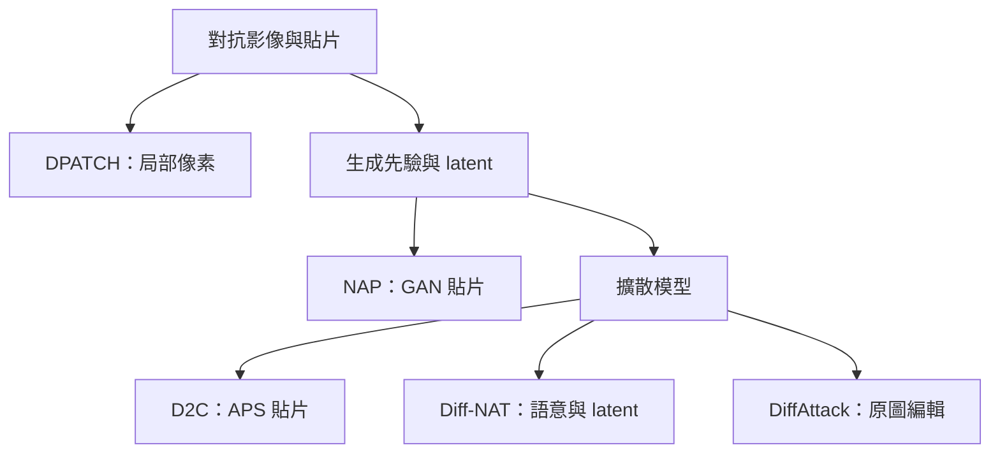
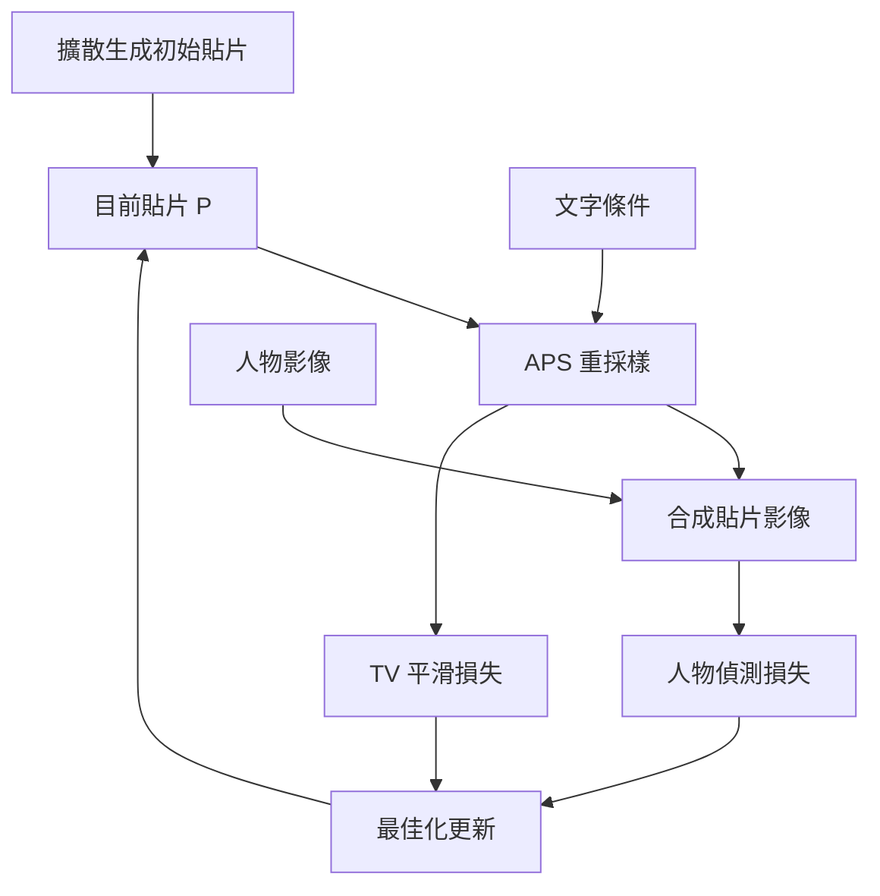

# 對抗貼片與擴散模型｜LLM Wiki

目前整合 5 個使用者選定來源。從學習總覽與入門概念開始，再閱讀方法比較及逐篇證據；引用可在本文件內跳轉。

> 閱讀範圍：正文文字已整理；原圖表、完整公式與部分補充資料仍待核對。來源維持 partial，來源數量達標不等於整份作業、實驗重現或視覺驗收完成。

## 閱讀導覽

| 順序 | 頁面 | 類型 |
| --- | --- | --- |
| 1 | [對抗貼片與擴散模型：學習總覽](#對抗貼片與擴散模型學習總覽) | 概念／方法 |
| 2 | [對抗貼片入門：局部圖案如何影響模型](#對抗貼片入門局部圖案如何影響模型) | 概念／方法 |
| 3 | [攻擊目標與局部 person 偽陽性](#攻擊目標與局部-person-偽陽性) | 概念／方法 |
| 4 | [生成先驗與 latent 空間：最佳化究竟改了什麼](#生成先驗與-latent-空間最佳化究竟改了什麼) | 概念／方法 |
| 5 | [自然性對抗貼片：GAN 與擴散方法](#自然性對抗貼片gan-與擴散方法) | 概念／方法 |
| 6 | [Diffusion to Confusion：方法總覽](#diffusion-to-confusion方法總覽) | 概念／方法 |
| 7 | [APS：對抗貼片重採樣](#aps對抗貼片重採樣) | 概念／方法 |
| 8 | [語意與 latent 雙層最佳化](#語意與-latent-雙層最佳化) | 概念／方法 |
| 9 | [自然性、知覺差異與攻擊指標](#自然性知覺差異與攻擊指標) | 概念／方法 |
| 10 | [轉移性與威脅模型](#轉移性與威脅模型) | 概念／方法 |
| 11 | [人物偵測逃避與 AP／mAP 評估](#人物偵測逃避與-apmap-評估) | 概念／方法 |
| 12 | [五篇研究比較：任務、搜尋空間與評估邊界](#五篇研究比較任務搜尋空間與評估邊界) | 跨來源比較 |
| 13 | [DPATCH：讓偵測器關注貼片的局部攻擊](#dpatch讓偵測器關注貼片的局部攻擊) | 來源筆記 |
| 14 | [NAP：在 GAN latent 空間尋找自然性貼片](#nap在-gan-latent-空間尋找自然性貼片) | 來源筆記 |
| 15 | [Diffusion to Confusion：ICIP 2025 版](#diffusion-to-confusionicip-2025-版) | 來源筆記 |
| 16 | [Diff-NAT：同時搜尋生成語意與 latent 的自然性貼片](#diff-nat同時搜尋生成語意與-latent-的自然性貼片) | 來源筆記 |
| 17 | [DiffAttack：以擴散 latent 擾動整張分類影像](#diffattack以擴散-latent-擾動整張分類影像) | 來源筆記 |

---

## 對抗貼片與擴散模型：學習總覽

這個 Wiki 以五篇使用者選定的研究，回答一個學習問題：**局部圖案如何影響偵測器？生成模型又能如何約束圖案外觀、提供搜尋空間？** 同時把整張影像的分類攻擊分開，避免混用任務與指標。[S002-C02](#s002-c02) [S003-C02](#s003-c02) [S005-C02](#s005-c02)

### 從零開始的閱讀順序

| 學習問題 | 閱讀頁面 | 看完應能說明 |
| --- | --- | --- |
| 貼片究竟改變哪裡？ | [對抗貼片入門](#對抗貼片入門局部圖案如何影響模型) | 局部貼片與整張影像擾動的差別 |
| 攻擊成功代表什麼？ | [攻擊目標與局部偽陽性](#攻擊目標與局部-person-偽陽性) | 分類、偵測逃避、指定類別及局部 FP 的驗收差異 |
| 為什麼要用生成模型？ | [生成先驗與 latent 空間](#生成先驗與-latent-空間最佳化究竟改了什麼) | 直接更新像素、GAN latent、diffusion latent 的差別 |
| 生成過程如何接到最佳化？ | [D2C 方法總覽](#diffusion-to-confusion方法總覽)與 [APS](#aps對抗貼片重採樣) | 初始化、重採樣、文字條件與 detector loss 的角色 |
| prompt 能不能一起更新？ | [語意與 latent 雙層最佳化](#語意與-latent-雙層最佳化) | Diff-NAT 的可學習類別 embedding 與 latent 分工 |
| 如何衡量外觀與攻擊？ | [自然性與知覺指標](#自然性知覺差異與攻擊指標) | AP、accuracy、主觀自然性、FID、LPIPS不能互換 |
| 換模型或進入實體後怎麼看？ | [轉移性與威脅模型](#轉移性與威脅模型) | 可用 surrogate、未知 target、數位與實體驗證的界線 |

### 五個來源各負責什麼

| 來源 | 本 Wiki 的定位 | 先注意的邊界 |
| --- | --- | --- |
| [S002：DPATCH](#dpatch讓偵測器關注貼片的局部攻擊) | 偵測器上的局部像素貼片與指定類別攻擊 | 作者容許部分框定位不準；整體 mAP 不是局部 FP ASR |
| [S003：NAP](#nap在-gan-latent-空間尋找自然性貼片) | 用 GAN latent 搜尋自然性貼片 | 生圖類別與被攻擊的 person 類別不同 |
| [S001：D2C](#diffusion-to-confusionicip-2025-版) | 文字條件式 diffusion 與 APS 的貼片最佳化 | 主要是人物偵測逃避，完整公式仍待核對 |
| [S004：Diff-NAT](#diff-nat同時搜尋生成語意與-latent-的自然性貼片) | 生成語意與 latent 交替搜尋 | 已含 AdamW／MI-FGSM；不代表已驗證本研究的 person FP |
| [S005：DiffAttack](#diffattack以擴散-latent-擾動整張分類影像) | 整張分類影像的 inversion、latent 與注意力控制 | 不是通用貼片，也不是物件偵測實驗 |

以上定位的依據詳見各來源的研究目標與證據段落；完整五面向對照見[五篇研究比較](#五篇研究比較任務搜尋空間與評估邊界)。

### 知識關係圖

這是方法類型的概念關係，不表示所有箭頭都是論文的直接繼承關係；它也不是作業所需的資料處理工作流程 graph，後者另行整理。

定位依據：[S002-C04](#s002-c04)、[S003-C02](#s003-c02)、[S001-C03](#s001-c03)、[S004-C03](#s004-c03)、[S005-C03](#s005-c03)。

### 三個容易混淆的地方

**生成 dog 圖案，不等於攻擊 dog 類別。** NAP／D2C／Diff-NAT 可以用狗或其他圖案生成貼片，卻以降低 person 偵測為目標。[S003-C03](#s003-c03) [S003-C05](#s003-c05) [S001-C05](#s001-c05) [S004-C11](#s004-c11)

**使用 AdamW，不等於增加了一個新的語意搜尋變數。** Diff-NAT 的跨語意搜尋來自可更新的類別 embedding；AdamW 是更新該變數的 optimizer。[S004-C03](#s004-c03) [S004-C05](#s004-c05)

**低 AP、低分類 accuracy、自然性高票與低 LPIPS各自回答不同問題。** 不把它們直接換算成「貼片附近新增 person 框」的成功率。[S001-C07](#s001-c07) [S003-C09](#s003-c09) [S004-C08](#s004-c08) [S005-C09](#s005-c09)

### 如何連到目前研究

使用者目前關注的條件是「貼片周圍至少一個新增 person 框」。這是**使用者研究設定**，不是五篇資料共同已驗證的成功定義。DPATCH 提供指定貼片類別的概念參考；其他三篇生成式貼片文獻主要提供外觀與搜尋機制；DiffAttack 提供另一種 latent／注意力控制思路。[攻擊目標概念頁](#攻擊目標與局部-person-偽陽性)

跨來源推論（信心：中）：可以把生成機制與攻擊目標分開評估，但改造是否同時提升自然性、FP 成功與穩健性仍未知，需實驗，不能由文獻組合直接保證。

### 閱讀狀態與信心

五個不同來源均已建立來源筆記、核心內容與可回查證據；本次以可取得的文字為主，原圖表、完整公式與部分外部補充資料仍待核對，均如實標為 partial。**來源數量已達五篇，不代表已完成完整視覺核對、實驗重現或整份作業。**

信心：高，對上述任務分類與可定位文字；中，對需要公式／圖像核對的機制細節；未知，對尚未執行的 FP 改造效果。

[回到閱讀導覽](#閱讀導覽)

---

## 對抗貼片入門：局部圖案如何影響模型

### 先想像一個例子

一張照片中有真實人物，人物衣服上放了一塊圖案；如果圖案經特別最佳化後，使偵測器更難找出人物，就是本批 NAP、D2C、Diff-NAT 所研究的貼片效果。[S003-C03](#s003-c03) [S001-C02](#s001-c02) [S004-C02](#s004-c02)

重點是圖案如何被設計、貼到哪裡、想改變哪種輸出；不是任意一張圖片貼上去，就自動稱為成功的對抗貼片。

### 定義與攻擊單位

在這些來源中，貼片只修改影像的一部分；偵測器需要輸出類別及框。DPATCH 同時考慮分類與位置，因此比「整張圖片最後被分成哪一類」多了定位問題。[S002-C02](#s002-c02) [S002-C04](#s002-c04)

| 類型 | 修改／產生的對象 | 此批來源 |
| --- | --- | --- |
| 局部像素貼片 | 直接更新局部圖案像素 | [DPATCH](#s002-c04) |
| 生成式貼片 | 透過 GAN 或 diffusion 的變數產生局部圖案 | [NAP](#s003-c02)、[D2C](#s001-c03)、[Diff-NAT](#s004-c03) |
| 整張影像的分類攻擊 | 對每張原圖做 inversion 與重建最佳化 | [DiffAttack](#s005-c02) |

### 數位與實體是不同驗證

數位合成是在影像中放入圖案；實體測試還需要印出、拍攝，面對相機、距離與光照等變動。NAP 的 T-shirt 錄影是實體 protocol 的一個例子；在電腦合成成功，不直接證明所有實體條件成立。[S003-C10](#s003-c10) [S003-C11](#s003-c11)

### 學習檢查

讀完後應能回答：目前談的是一塊可跨影像使用的圖案，還是每張圖片各自重新攻擊？模型輸出是單一類別，還是多個類別與框？這會影響後續的[攻擊目標](#攻擊目標與局部-person-偽陽性)與[評估方式](#自然性知覺差異與攻擊指標)。

### 信心與限制

信心：高，定義按這五篇的實際任務整理；不主張覆蓋所有對抗攻擊形式。原圖表未全部核對，效果仍以各來源的條件為準。

### 相關頁面

- [學習總覽](#對抗貼片與擴散模型學習總覽)
- [生成先驗與 latent 空間](#生成先驗與-latent-空間最佳化究竟改了什麼)
- [五篇研究比較](#五篇研究比較任務搜尋空間與評估邊界)

[回到閱讀導覽](#閱讀導覽)

---

## 攻擊目標與局部 person 偽陽性

### 先看輸出，再談成功

「讓模型出錯」仍不夠具體。要先說明錯在分類、漏掉人物、把貼片判成指定物體，還是框的位置不對。[S002-C02](#s002-c02) [S002-C03](#s002-c03) [S005-C02](#s005-c02)

| 目標 | 來源中的做法 | 不能直接推得的事情 |
| --- | --- | --- |
| 人物偵測逃避 | NAP／D2C／Diff-NAT 降低 person 偵測分數 | 不代表產生了新的 person 框 |
| 指定貼片類別 | DPATCH 用指定類別及框標籤最佳化 | 不保證所有框都精準落在貼片附近 |
| 分類器預測改變 | DiffAttack 使原圖分類偏離原標籤 | 不代表已攻擊物件偵測器 |

依據：[S003-C03](#s003-c03)、[S001-C02](#s001-c02)、[S004-C02](#s004-c02)、[S002-C07](#s002-c07)、[S005-C02](#s005-c02)。

### 目前研究的成功條件

**使用者研究設定：貼片周圍至少出現一個新增 person 框。** 此設定來自本專案已確認的研究目標，不冒充任一來源的原文定義。

它需要另外指定判定框與貼片的空間關係，例如中心或交集的規則，並處理乾淨影像已有偵測的情況。具體門檻與配對方式尚未在本 Wiki 定案；五篇研究不能代替這項驗收設計。

跨來源推論（信心：高）：DPATCH 對指定貼片類別有概念關聯，但作者容許部分定位不準，所以不能直接採其整體 mAP 作為本研究的局部成功率。[S002-C04](#s002-c04) [S002-C07](#s002-c07) [S002-C11](#s002-c11)

### 生成類別與攻擊類別

NAP 的生成器可以產生 dog 圖案，D2C 可以用博美犬 prompt，Diff-NAT 可以更新類別 token；三者的 person 逃避目標仍與這些圖案語意分開。[S003-C05](#s003-c05) [S001-C05](#s001-c05) [S004-C11](#s004-c11)

因此「尋找容易攻擊的生成類別」與「把偵測器目標換成另一類」不能混稱同一件事。

### 指標與限制

AP／mAP 下降、top-1 accuracy 下降與局部 person FP 成功率的定義不同，不能只做 100% 減法互換。[S001-C07](#s001-c07) [S004-C08](#s004-c08) [S005-C09](#s005-c09)

信心：高，對任務邊界與來源支持；未知，對尚未實作驗證的 FP 損失及空間判準。

### 相關頁面

- [對抗貼片入門](#對抗貼片入門局部圖案如何影響模型)
- [人物偵測逃避與 mAP](#人物偵測逃避與-apmap-評估)
- [五篇研究比較](#五篇研究比較任務搜尋空間與評估邊界)
- [學習總覽](#對抗貼片與擴散模型學習總覽)

[回到閱讀導覽](#閱讀導覽)

---

## 生成先驗與 latent 空間：最佳化究竟改了什麼

### 一個具體對照

DPATCH 直接更新貼片像素；NAP 則調整生成器輸入 z，讓 G(z) 產生貼片。後者把可搜尋的圖案與預訓練生成器所學到的影像分布連在一起，這是本批來源所稱自然影像生成先驗的用法。[S002-C04](#s002-c04) [S003-C02](#s003-c02)

### 四種需要分清楚的變數

| 最佳化變數 | 來源用法 | 作用範圍 |
| --- | --- | --- |
| 貼片像素 | DPATCH | 直接控制局部圖案 |
| GAN latent z | NAP | 經預訓練 G(z) 產生貼片 |
| Diffusion 生成條件與 latent | D2C／Diff-NAT | 經去噪與解碼產生圖案；不同方法的可學習變數不一樣 |
| 原圖 inversion latent xt | DiffAttack | 以原圖為起點，重建並改變該張影像 |

依據：[S002-C04](#s002-c04)、[S003-C02](#s003-c02)、[S001-C03](#s001-c03)、[S004-C03](#s004-c03)、[S005-C03](#s005-c03)。

### 為什麼仍需要約束

NAP 對 latent 各維做 clipping；D2C 用文字條件維持語意；Diff-NAT 共同更新類別 embedding 與 latent 並限制 latent；DiffAttack 則用注意力與 inversion strength 保留原圖內容。使用生成器並不代表每一次攻擊更新都自動達成外觀要求。[S003-C04](#s003-c04) [S001-C05](#s001-c05) [S004-C04](#s004-c04) [S005-C06](#s005-c06)

### 擴散時間與採樣步數

D2C 的 T=1000／t_start=500、Diff-NAT 的 DDIM 50 steps、DiffAttack 的採樣 20 steps／inversion 5 steps，描述不同層次的設定。比較時保留完整 sampler、排程與起點，不能僅看數字比例就當成相同雜訊強度。[S001-C04](#s001-c04) [S004-C05](#s004-c05) [S005-C07](#s005-c07)

### 信心與待查

信心：高，對文字明確列出的最佳化變數；中，對完整公式、步數排程與實作對應，需核對原文圖式和程式。

### 相關頁面

- [APS](#aps對抗貼片重採樣)
- [語意與 latent 雙層最佳化](#語意與-latent-雙層最佳化)
- [自然性貼片](#自然性對抗貼片gan-與擴散方法)
- [學習總覽](#對抗貼片與擴散模型學習總覽)

[回到閱讀導覽](#閱讀導覽)

---

## 自然性對抗貼片：GAN 與擴散方法

> 本頁整合 NAP、D2C 與 Diff-NAT 的外觀機制及評估設計；原圖表與部分細節仍待視覺核對。

### 定義

S001 利用在自然影像上預訓練的擴散模型與文字條件，希望貼片保留可辨認的語意外觀，同時達到人物偵測逃避。作者把文字條件視為維持自然性的隱式約束。[S001-C05](#s001-c05) [S001-C02](#s001-c02)

NAP 則以預訓練 GAN 及 latent clipping 約束圖案；Diff-NAT 將生成類別 embedding 與 latent 都納入最佳化。三篇共同關心外觀與攻擊，但約束方式不同，不表示外觀分數可以直接相互替代。[S003-C02](#s003-c02) [S003-C04](#s003-c04) [S004-C03](#s004-c03)

### 何時適用

在引用 S001 的自然性結果時，需區分兩種主觀評估：

| 評估 | 問的是什麼 | 可支持的範圍 |
| --- | --- | --- |
| 自然／不自然判定 | 每張影像是否符合問卷提供的自然性定義 | 該問卷設定下的自然判定比例 |
| 成對偏好 | 同一 detector 下，兩種方法產生的貼片哪個較自然 | 相對偏好，不等於絕對自然判定率 |

兩種設計均見 [S001-C10](#s001-c10)。目前不引用尚未視覺核對的表格百分比，也不將這些評估當成攻擊成功率。

### 不同來源如何使用此概念

| 來源 | 用法與條件 | 證據 |
| --- | --- | --- |
| S001 | SD v1.4、文字條件與人物偵測逃避；主觀問卷比較自然性 | [S001-C05](#s001-c05)、[S001-C10](#s001-c10) |
| S003 | GAN latent clipping；二元自然判定與排序研究 | [S003-C04](#s003-c04)、[S003-C09](#s003-c09) |
| S004 | 生成語意與 latent 交替搜尋；45 人各選四張自然貼片 | [S004-C03](#s004-c03)、[S004-C09](#s004-c09) |

### 跨來源整理

跨來源推論（信心：高）：自然性需要保留生成方法、問卷與候選圖片的條件，不能只依問卷百分比排名。NAP 的 trade-off 是其 GAN 設定的觀察；Diff-NAT 嘗試擴大生成語意搜尋，尚不構成跨設定的普遍優劣證明。[S003-C12](#s003-c12) [S004-C11](#s004-c11)

### 矛盾、限制與待查

- 保持文字條件與「所有 prompt 都同樣好」是不同主張；後者尚未證實。[S001-C05](#s001-c05)
- SAC 防禦測試衡量的是特定防禦下的攻擊效果，主觀自然性問卷則問人類觀感，不能混為同一個指標。[S001-C11](#s001-c11) [S001-C10](#s001-c10)
- 圖 1–2 與表 4–7 尚待視覺核對；不把作者宣稱提升成已獨立重現的事實。[S001-C12](#s001-c12)

### 信心程度

**高**：對主觀評估設計與文字條件角色的整理有正文依據。**中**：對自然性優勢的確認仍缺原圖表核對與獨立驗證。

### 相關頁面

- [Diffusion to Confusion：方法總覽](#diffusion-to-confusion方法總覽)
- [S001：Diffusion to Confusion](#diffusion-to-confusionicip-2025-版)
- [APS](#aps對抗貼片重採樣)
- [人物偵測逃避與評估](#人物偵測逃避與-apmap-評估)
- [NAP 來源筆記](#nap在-gan-latent-空間尋找自然性貼片)
- [Diff-NAT 來源筆記](#diff-nat同時搜尋生成語意與-latent-的自然性貼片)
- [自然性與知覺指標](#自然性知覺差異與攻擊指標)
- [學習總覽](#對抗貼片與擴散模型學習總覽)

[回到閱讀導覽](#閱讀導覽)

---

## Diffusion to Confusion：方法總覽

**Diffusion to Confusion（D2C）將文字條件式擴散生成接到對抗貼片最佳化中，讓貼片在保留語意外觀的同時，降低人物被偵測的信心。** 本頁是方法導覽，可由下方連結進入概念說明與原文證據。[S001-C02](#s001-c02) [S001-C03](#s001-c03) [S001-C05](#s001-c05)

> 閱讀範圍：目前依 S001 的六頁文字整理；圖表、完整公式與結果數值仍待原 PDF 視覺核對。這些限制不會被寫成已確認結果。

### 這個方法處理什麼問題

S001 關注貼片的攻擊效果與外觀：既要影響人物偵測，也希望圖案保留自然、可辨認的語意。作者採用文字條件式擴散模型生成與重採樣貼片，再以 detector objective 引導最佳化。[S001-C02](#s001-c02) [S001-C03](#s001-c03) [S001-C05](#s001-c05)

本文的實驗是**人物偵測逃避**：把貼片放在有人物的影像上，降低 person 偵測信心。本篇沒有驗證「在無人背景上，讓貼片附近新增 person 框」的偽陽性任務。[S001-C02](#s001-c02) [S001-C06](#s001-c06)

### 方法如何運作

這張圖依已讀文字整理運作關係，不是原論文圖 2 的重製；不指定尚未核對的 latent 張量介面。

流程依據：[APS 與初始化](#s001-c03)、[detector 與 TV 目標](#s001-c02)、[影像合成](#s001-c08)。

| 元件 | 在本篇中的工作 | 深入閱讀 |
| --- | --- | --- |
| APS | 以擴散模型生成／重採樣貼片，銜接目前貼片與最佳化目標 | [APS 概念頁](#aps對抗貼片重採樣) |
| 文字條件 | 在最佳化時維持圖案語意，作者將其視為自然性的隱式約束 | [自然性概念頁](#自然性對抗貼片gan-與擴散方法) |
| Detector loss | 降低 person 相關偵測信心，形成本文的逃避攻擊方向 | [人物偵測逃避](#人物偵測逃避與-apmap-評估) |
| TV loss | 作為影像平滑正則化，與 detector loss 一起最佳化 | [目標函數證據](#s001-c02) |
| Checkpointing／AMB | 處理擴散反向傳播的記憶體需求，使用不同實驗組態 | [實驗設定證據](#s001-c04) |

### 如何理解關鍵設定

**t_start 與去噪次數是需要分開記錄的設定。** 本篇多數結果使用 T=1000、t_start=500，但 checkpointing 組在最佳化時去噪 3 次，AMB 組則為 10 次。不能只看到 t_start=500，就把兩組實驗視為相同流程。[S001-C04](#s001-c04)

本文實驗段落寫的是 **Adam**，起始 learning rate 為 0.005。SD v1.4 是主要模型；這份來源不能證明 AdamW 或 MI-FGSM 已在此方法中驗證有效。[S001-C04](#s001-c04) [S001-C05](#s001-c05)

### 如何讀它的評估結果

| 面向 | 本篇如何評估 | 解讀重點 |
| --- | --- | --- |
| 攻擊效果 | 以乾淨影像預測為參考，將乾淨 mAP 標準化為 100% | 衡量貼片造成的偵測退化，不能直接換算成偽陽性 ASR |
| 自然性 | 自然／不自然判定，以及與另一方法的成對偏好 | 絕對判定與相對偏好是兩種問題，比例不可互換 |
| 轉移與防禦 | 跨 detector 評估，以及 SAC 貼片移除防禦 | 結論限於被測模型與防禦，不能擴張成所有模型都有效 |
| 實體測試 | T-shirt 貼片與特定受試者、相機、距離及場景 | 不能據此涵蓋所有距離、角度、背景與材質 |

評估依據：[mAP 流程](#s001-c07)、[主觀研究](#s001-c10)、[轉移／SAC](#s001-c11)、[實體設定](#s001-c09)。

目前不把尚未視覺核對的結果表百分比寫成已驗證成績；詳細設定與證據請讀[論文筆記](#diffusion-to-confusionicip-2025-版)。

### 與偽陽性貼片研究的關係

這篇可以作為「擴散式貼片生成、文字條件維持語意、人物偵測逃避」的來源。將其改為 person 偽陽性任務時，攻擊方向、成功定義及評估方式仍需另外驗證；本文不足以替這些改造背書。[S001-C02](#s001-c02) [S001-C07](#s001-c07)

### 來源、信心與待查

- 本頁 D2C 方法定義依 [S001：ICIP 2025 論文筆記](#diffusion-to-confusionicip-2025-版)。Wiki 現已另納入四篇來源，跨來源對照見[五篇研究比較](#五篇研究比較任務搜尋空間與評估邊界)。
- 信心：**高**，對目標方向、文字條件角色與明確記載的設定有正文支持；**中**，對 APS 完整機制與自然性優勢仍待圖表、公式核對。
- 待查：完整 APS 遞迴式、原圖表、表格數值及評估實作細節，見 [S001-C12](#s001-c12)。

### 繼續閱讀

- [Wiki 首頁](#閱讀導覽)
- [APS](#aps對抗貼片重採樣)
- [自然性對抗貼片](#自然性對抗貼片gan-與擴散方法)
- [人物偵測逃避與評估](#人物偵測逃避與-apmap-評估)
- [NAP 的 GAN latent 方法](#nap在-gan-latent-空間尋找自然性貼片)
- [Diff-NAT 的語意與 latent 搜尋](#diff-nat同時搜尋生成語意與-latent-的自然性貼片)
- [學習總覽](#對抗貼片與擴散模型學習總覽)

[回到閱讀導覽](#閱讀導覽)

---

## APS：對抗貼片重採樣

> APS 的定義依 S001；另與 S004、S005 的擴散流程對照。三篇的流程名稱與初始化不同，完整公式及原圖表仍待核對。

### 定義

在 S001 中，Adversarial Patch Sampling（APS）以文字條件式 LDM 產生或重採樣貼片，輸入包含貼片、起始擴散時間、步長與文字條件。初始貼片從雜訊生成；最佳化中的重採樣貼片記為 P′ = APS(P, t_start, s, c_P)。[S001-C03](#s001-c03)

### 何時適用

此處整理的是「以擴散生成流程銜接貼片目標函數」的本篇設計。S001 的 detector loss 針對降低 person 偵測信心；APS 名稱本身並不代表偽陽性攻擊已被驗證。[S001-C02](#s001-c02)

| 容易混淆的項目 | 本篇可確認內容 | 證據 |
| --- | --- | --- |
| t_start 與去噪次數 | 多數結果 t_start=500，但 checkpointing 與 AMB 分別使用 3 與 10 次去噪 | [S001-C04](#s001-c04) |
| 文字條件與攻擊目標 | 文字條件維持語意外觀，detector objective 決定逃避方向 | [S001-C05](#s001-c05)、[S001-C02](#s001-c02) |
| 生成流程與 optimizer | 正文實驗使用 Adam；不能改寫成已驗證 AdamW／MI-FGSM | [S001-C04](#s001-c04) |

### 不同來源如何使用此概念

| 來源 | 定義／用法 | 證據 |
| --- | --- | --- |
| S001 | APS 產生初始貼片並在最佳化中重採樣 | [S001-C03](#s001-c03) |
| S004 | Diff-NAT 由可學習文字條件與 latent 生成貼片，不把它自動改稱 APS | [S004-C03](#s004-c03) |
| S005 | 從原圖做 DDIM inversion 再重建；不是從純雜訊初始化通用貼片 | [S005-C03](#s005-c03) |

### 跨來源整理

跨來源推論（信心：高）：共同使用 diffusion 不代表相同攻擊單位或初始化。D2C 的 t_start、Diff-NAT 的 DDIM 50 steps、DiffAttack 的 20 steps／5 次 inversion 需連同排程與原圖條件記錄，不直接以數字比例互換。[S001-C04](#s001-c04) [S004-C05](#s004-c05) [S005-C07](#s005-c07)

### 矛盾、限制與待查

第 2 頁擷取文字混雜；Algorithm 1 完整遞迴式、索引及程式張量對應未核對，因此不由此頁生成聲稱精確復現的程式。[S001-C12](#s001-c12)

### 信心程度

**中**：流程與實驗設定有可定位的正文支持，但完整公式與實作尚未核對。

### 相關頁面

- [Diffusion to Confusion：方法總覽](#diffusion-to-confusion方法總覽)
- [S001：Diffusion to Confusion](#diffusion-to-confusionicip-2025-版)
- [自然性對抗貼片](#自然性對抗貼片gan-與擴散方法)
- [人物偵測逃避與評估](#人物偵測逃避與-apmap-評估)
- [生成先驗與 latent 空間](#生成先驗與-latent-空間最佳化究竟改了什麼)
- [Diff-NAT 來源筆記](#diff-nat同時搜尋生成語意與-latent-的自然性貼片)
- [DiffAttack 來源筆記](#diffattack以擴散-latent-擾動整張分類影像)
- [學習總覽](#對抗貼片與擴散模型學習總覽)

[回到閱讀導覽](#閱讀導覽)

---

## 語意與 latent 雙層最佳化

### Diff-NAT 的兩個層次

Diff-NAT 將生成 prompt 的類別 token embedding 設成可更新變數，再調整 instance-level latent。作者分別以 AdamW 與 MI-FGSM 更新，形成交替最佳化。[S004-C03](#s004-c03) [S004-C04](#s004-c04) [S004-C05](#s004-c05)

| 層次 | 改變什麼 | 不要誤解成 |
| --- | --- | --- |
| 語意層 | 生成類別的連續 token embedding | 用梯度直接更新離散文字、或改變 person 攻擊目標 |
| Instance 層 | diffusion latent 中的細部生成變數 | 直接在整張原始影像像素上做同樣範圍的擾動 |

**AdamW 是更新方式；把語意 embedding 納入最佳化，才是此處新增搜尋自由度的來源。** [S004-C03](#s004-c03) [S004-C11](#s004-c11)

### 與固定條件的差別

NAP 可以人工指定不同生成類別，D2C 也能選不同 prompt 做實驗；Diff-NAT 的差別是讓條件在同一次攻擊搜尋中參與更新，不能把前兩篇說成完全不能換圖案主題。[S003-C12](#s003-c12) [S001-C05](#s001-c05) [S004-C03](#s004-c03)

### 為什麼 DiffAttack 對文字擾動的結論不同？

DiffAttack 研究的是保留原圖內容的分類轉移攻擊，並比較某種文字擾動與 latent 擾動；其作者觀察文字擾動較難轉移。Diff-NAT 則在生成新貼片時調整類別 embedding，且目標是 person 偵測逃避。[S005-C02](#s005-c02) [S005-C06](#s005-c06) [S005-C10](#s005-c10) [S004-C02](#s004-c02)

跨來源推論（信心：高）：兩者的任務、起始影像與約束不同，不能把其中一篇結論擴張為「所有 prompt 更新都有效／無效」。目前沒有在同一 protocol 下做直接比較。

### 對目前研究的限制

AdamW＋MI-FGSM 的雙層組合已出現在 Diff-NAT；本研究若採用，需清楚引用並說明改變的是哪個任務或元件。改成局部 person 偽陽性後的效果仍未知，不能單憑這套組合宣稱成功。[S004-C05](#s004-c05) [攻擊目標](#攻擊目標與局部-person-偽陽性)

### 信心與待查

對變數與 optimizer 分工的信心為高；精確 token 位置、15／200 epochs 如何配合總 630 epochs，以及 MI-FGSM norm 等實作細節仍待核對。[S004-C04](#s004-c04) [S004-C05](#s004-c05)

### 相關頁面

- [Diff-NAT 來源筆記](#diff-nat同時搜尋生成語意與-latent-的自然性貼片)
- [DiffAttack 來源筆記](#diffattack以擴散-latent-擾動整張分類影像)
- [生成先驗與 latent](#生成先驗與-latent-空間最佳化究竟改了什麼)
- [五篇研究比較](#五篇研究比較任務搜尋空間與評估邊界)
- [學習總覽](#對抗貼片與擴散模型學習總覽)

[回到閱讀導覽](#閱讀導覽)

---

## 自然性、知覺差異與攻擊指標

### 指標先回答問題，再比較數字

| 想知道什麼 | 來源中的做法 | 解讀界線 |
| --- | --- | --- |
| 貼片是否像自然圖案？ | NAP、D2C 的人類自然／不自然判定 | 取決於問卷定義、圖片與參與者 |
| 兩個方法哪個更自然？ | D2C 的成對偏好 | 相對偏好不等於絕對自然判定率 |
| 一組候選中哪些最自然？ | Diff-NAT 每人選四張 | 得票受候選集合與名額影響 |
| 重建影像與原圖差多少？ | DiffAttack 使用 full-reference LPIPS | 衡量兩張圖的知覺差異，不直接等於獨立貼片的自然性 |
| 生成影像集的品質如何？ | DiffAttack 使用 FID | 需要保留其影像集設定，不與問卷百分比互換 |
| 攻擊是否使模型退化？ | 偵測 AP／mAP 或分類 accuracy | 需保留標籤、分母與任務，不直接換成局部 FP ASR |

依據：[S003-C09](#s003-c09)、[S001-C10](#s001-c10)、[S004-C09](#s004-c09)、[S005-C09](#s005-c09)、[S002-C07](#s002-c07)。

### 主觀自然性的三份研究不可直接合併

| 來源 | 參與者與設計 | 注意 |
| --- | --- | --- |
| NAP | 兩組各 24 人；另有 10 人排序實驗 | 是不同實驗，不直接加總成一個問卷結果 |
| D2C | 114 人；包含二元判定與成對偏好 | 兩種問題對應不同分數 |
| Diff-NAT | 45 人；每人從集合選四張 | 不等同每張圖獨立回答是／否 |

分別見 [S003-C09](#s003-c09)、[S001-C10](#s001-c10)、[S004-C09](#s004-c09)。

跨來源推論（信心：高）：測量設計不同，不能只把較高的百分比排成「自然性最好的方法」。目前尚未完成原問卷圖片與所有結果表的核對。

### AP 與 accuracy 不能取代局部成功條件

NAP／D2C 的乾淨預測參考與標準化 mAP，和 Diff-NAT 的 AP 敘述、DiffAttack 的分類 accuracy，必須分別保留 protocol。即使指標數字相同，也不表示達到相同攻擊。[S003-C08](#s003-c08) [S001-C07](#s001-c07) [S004-C08](#s004-c08) [S005-C09](#s005-c09)

使用者的局部 person FP 研究需先訂新增框與貼片位置的成功判準，再統計成功率；不能直接以 100% 減去上述任一數值。[攻擊目標與局部 FP](#攻擊目標與局部-person-偽陽性)

### 信心與待查

對各指標的來源用途與問卷設計，信心高；跨論文的量化優劣仍未對齊，沒有做排名。圖表及部分評估實作仍待核對。

### 相關頁面

- [自然性貼片](#自然性對抗貼片gan-與擴散方法)
- [人物偵測逃避與 mAP](#人物偵測逃避與-apmap-評估)
- [五篇研究比較](#五篇研究比較任務搜尋空間與評估邊界)
- [學習總覽](#對抗貼片與擴散模型學習總覽)

[回到閱讀導覽](#閱讀導覽)

---

## 轉移性與威脅模型

### 「黑箱」需要補上哪一段未知

DPATCH 先在可用的偵測器上產生貼片，再測其他模型；DiffAttack 也在 surrogate 分類器上最佳化，再測未知目標。測試時不知道 target 的參數，不等於整個產生流程從未使用模型或梯度。[S002-C08](#s002-c08) [S005-C12](#s005-c12)

### 哪些變動算哪一種檢查

| 變動 | 這批來源中的例子 | 需保留的條件 |
| --- | --- | --- |
| 換 detector／classifier | DPATCH、D2C、DiffAttack 的跨模型測試 | 哪個模型產生、哪個模型測試、是否排除來源模型 |
| 換資料集 | NAP 的 INRIA／MPII，Diff-NAT 的跨資料測試 | 訓練與測試切分、人物範圍、相同貼片是否沿用 |
| 換影像轉換 | NAP 的 rotation、blur 等消融 | 哪些在訓練使用、哪些只在測試使用 |
| 從數位到實體 | NAP、D2C、Diff-NAT 的印刷拍攝 | 尺寸、距離、人員、相機、場景與統計方式 |
| 加入防禦 | D2C 的 SAC、DiffAttack 的分類防禦 | 被測防禦是否相同，不能跨任務直接排名 |

依據：[S001-C11](#s001-c11)、[S002-C08](#s002-c08)、[S003-C07](#s003-c07)、[S003-C10](#s003-c10)、[S003-C11](#s003-c11)、[S004-C07](#s004-c07)、[S004-C12](#s004-c12)、[S005-C12](#s005-c12)。

### 不把局部結果擴張成全面穩健性

「某張貼片轉移到另一個模型」不代表對所有模型、背景、位置、seed 與物理條件均成立。這是依各來源限定實驗範圍所作的跨來源推論，信心高；對未測條件的效果則未知。

同樣地，rendering 模組能支援多種轉換，不代表主結果用了全部轉換。NAP 明確分開無額外轉換的主要比較與轉換消融；D2C 亦排除某些扭曲／形變，應按實驗逐項記錄。[S003-C10](#s003-c10) [S001-C08](#s001-c08)

### 學習檢查

讀一個「black-box／transferable／physical」主張時，先找出：使用了哪個可用模型、未知的是什麼、測試換了哪些條件、成功指標為何。如果缺少其中一項，先保留待查，避免把名稱當成完整驗證。

### 相關頁面

- [對抗貼片入門](#對抗貼片入門局部圖案如何影響模型)
- [攻擊目標](#攻擊目標與局部-person-偽陽性)
- [五篇研究比較](#五篇研究比較任務搜尋空間與評估邊界)
- [學習總覽](#對抗貼片與擴散模型學習總覽)

[回到閱讀導覽](#閱讀導覽)

---

## 人物偵測逃避與 AP／mAP 評估

> 本頁以 S001 的明確 protocol 為起點，對照 NAP、Diff-NAT 與 DPATCH。逃避偵測和局部新增 person 框仍是不同目標。

### 定義

在 S001 中，貼片被合成到有人物的影像，目標函數降低 person 的偵測信心。正文所述 detector loss 取 person 相關最大 objectness 與 class score 乘積，並與 TV loss 一起最小化。[S001-C02](#s001-c02) [S001-C08](#s001-c08)

### 何時適用

| 項目 | S001 設定 | 引用時應保留的條件 |
| --- | --- | --- |
| 資料用途 | INRIA Person 上貼片訓練與測試；COCO 用於 detector 預訓練 | 不能寫成 COCO 無人圖上的偽陽性貼片實驗 |
| 參考標籤 | detector 在乾淨測試影像上的預測 | 不能自行改稱人工 ground truth |
| 評估 | 乾淨狀態 mAP 標準化為 100%，貼片後越低表示退化越多 | 不能直接以 100%−mAP 當偽陽性 ASR |

資料用途見 [S001-C06](#s001-c06)，評估流程見 [S001-C07](#s001-c07)。

### 不同來源如何使用此概念

| 來源 | 用法 | 證據 |
| --- | --- | --- |
| S001 | 以逃避人物偵測為目標，用其特定參考標籤與標準化 mAP 評估 | [S001-C02](#s001-c02)、[S001-C07](#s001-c07) |
| S003 | person 分數最小化；數位使用乾淨預測參考，實體使用 recall | [S003-C03](#s003-c03)、[S003-C08](#s003-c08)、[S003-C11](#s003-c11) |
| S004 | person 分數最小化；報 AP，標籤／mask 細節仍待查 | [S004-C02](#s004-c02)、[S004-C06](#s004-c06)、[S004-C08](#s004-c08) |
| S002 | 可指定貼片類別，也以整體 mAP 退化判定偵測破壞 | [S002-C03](#s002-c03)、[S002-C07](#s002-c07) |

### 跨來源整理

跨來源推論（信心：高）：任務方向、標籤與 AP／recall protocol 需先對齊，才有量化比較的基礎。本頁沒有建立數值排名，亦不以 mAP 下降取代局部 FP 成功判定。

### 矛盾、限制與待查

- 已讀模型清單未包括 YOLOv8；此來源不能當成對 YOLOv8 已驗證的證據。[S001-C06](#s001-c06)
- 本文不能回答「貼片周圍新增 person 框」的成功判準或 ASR；那是尚未被本來源驗證的另一項研究需求。[S001-C02](#s001-c02) [S001-C07](#s001-c07)
- mAP 的 IoU 門檻、AP 實作及數值表格仍需核對，不預設它等於標準 COCO mAP@0.5:0.95。[S001-C07](#s001-c07)
- 沒有使用特定形變轉換不等於完全沒有影像轉換。[S001-C08](#s001-c08)

### 信心程度

**高**：對本篇目標方向、資料用途與參考標籤流程的判斷有可定位正文支持。**未知**：不同偵測器輸出介面、偽陽性改造與未核對評估細節的實際效果。

### 相關頁面

- [Diffusion to Confusion：方法總覽](#diffusion-to-confusion方法總覽)
- [S001：Diffusion to Confusion](#diffusion-to-confusionicip-2025-版)
- [APS](#aps對抗貼片重採樣)
- [自然性對抗貼片](#自然性對抗貼片gan-與擴散方法)
- [攻擊目標與局部偽陽性](#攻擊目標與局部-person-偽陽性)
- [NAP](#nap在-gan-latent-空間尋找自然性貼片)
- [Diff-NAT](#diff-nat同時搜尋生成語意與-latent-的自然性貼片)
- [DPATCH](#dpatch讓偵測器關注貼片的局部攻擊)
- [學習總覽](#對抗貼片與擴散模型學習總覽)

[回到閱讀導覽](#閱讀導覽)

---

## 五篇研究比較：任務、搜尋空間與評估邊界

### 比較範圍

此頁比較五個使用者選定版本的目標、方法、資料集、評估方式與限制。它們不是五組已對齊的實驗；本文不把原文數字併成排行榜。

### 五面向對照

| 來源 | 研究目標 | 方法／最佳化空間 | 資料集 | 評估方式 | 限制與未涵蓋範圍 |
| --- | --- | --- | --- | --- | --- |
| [S002：DPATCH](#dpatch讓偵測器關注貼片的局部攻擊) | 指定／非指定偵測破壞，包含讓貼片成為指定類別 | 局部像素；分類與框目標 | VOC 2007；COCO 轉移 | 整體 mAP 下降、跨模型／資料 | 沒有自然性生成先驗；作者容許部分定位不準；數值有待釐清差異 |
| [S003：NAP](#nap在-gan-latent-空間尋找自然性貼片) | 自然性人物逃避貼片 | 預訓練 GAN latent，clipping 與 TV | INRIA、選定 MPII 子集、實體影片 | 乾淨預測參考的數位 AP／mAP；實體 recall；主觀自然性 | GAN 與範圍造成取捨；不同實驗的轉換配置不同 |
| [S001：D2C](#diffusion-to-confusionicip-2025-版) | 文字條件式自然性人物逃避貼片 | LDM／APS 重採樣與 detector＋TV 目標 | INRIA、實體影片 | 標準化 mAP、主觀評估、跨模型、SAC | 不直接驗證局部 FP；原圖表與部分公式仍待查 |
| [S004：Diff-NAT](#diff-nat同時搜尋生成語意與-latent-的自然性貼片) | 擴張語意搜尋並兼顧自然性與人物逃避 | class token embedding＋latent；AdamW／MI-FGSM | INRIA、COCO-Person、CCTV-Person、自蒐圖、實體 | AP、45 人選四張的自然性研究 | AP protocol 與排程待核對；不驗證本研究的 person FP |
| [S005：DiffAttack](#diffattack以擴散-latent-擾動整張分類影像) | 整張分類影像不易察覺的轉移攻擊 | DDIM inversion latent＋cross／self-attention 控制 | ImageNet-Compatible、CUB、Cars | top-1 accuracy、FID、LPIPS、防禦／轉移 | 不是通用貼片或 detector 實驗；成本與 targeted transfer 等限制 |

目標與方法依據：[S002-C03](#s002-c03)、[S002-C04](#s002-c04)、[S003-C02](#s003-c02)、[S003-C03](#s003-c03)、[S001-C02](#s001-c02)、[S001-C03](#s001-c03)、[S004-C02](#s004-c02)、[S004-C03](#s004-c03)、[S005-C02](#s005-c02)、[S005-C03](#s005-c03)。

資料、評估與限制依據：[S002-C06](#s002-c06)、[S002-C07](#s002-c07)、[S003-C07](#s003-c07)、[S003-C08](#s003-c08)、[S003-C09](#s003-c09)、[S001-C06](#s001-c06)、[S001-C07](#s001-c07)、[S004-C07](#s004-c07)、[S004-C08](#s004-c08)、[S004-C09](#s004-c09)、[S005-C08](#s005-c08)、[S005-C09](#s005-c09)、[S005-C11](#s005-c11)。

### 可以比較什麼

- **最佳化對象：**局部像素、GAN latent、diffusion latent、可學習語意 embedding 的差別。
- **條件角色：**生成先驗如何限制圖案，哪些變數在同一次搜尋中可更新。
- **評估設計：**人物逃避、指定貼片類別、分類轉移各自測什麼。
- **知識缺口：**哪些原圖表、程式與 protocol 尚未讀到，不能填成「原文未報告」。

以上是方法／設計比較，不預設相同資源下的量化優劣。

### 不能直接比較什麼

| 未對齊的條件 | 為什麼影響結論 |
| --- | --- |
| 攻擊目標與輸出單位 | 分類預測錯誤、漏人、指定貼片類別與局部新增框不是同一成功定義 |
| 參考標籤與 AP 實作 | NAP／D2C 明述乾淨預測參考；Diff-NAT 仍有 protocol 待查 |
| 圖片與貼片尺寸 | 生成 256／512、合成尺寸、輸入 resize 都會改變實驗條件 |
| 模型與白箱／轉移設定 | 來源模型上的效果不能當成未知目標模型效果 |
| 主觀研究設計 | 24 人二元判斷、114 人混合設計、45 人選四張不是同一比例 |
| 計算成本與迭代單位 | epoch、iteration、去噪次數與 sampler 時間索引不同 |

相應條件見各來源設定與[自然性指標](#自然性知覺差異與攻擊指標)、[轉移性](#轉移性與威脅模型)。

### 表面矛盾如何處理

**Prompt 更新：**DiffAttack 的文字擾動轉移較弱，與 Diff-NAT 的生成類別更新有幫助，不能直接視為相互否定。前者保留原圖做分類攻擊，後者生成貼片做 person 逃避，變數與比較 protocol 不同。[S005-C10](#s005-c10) [S004-C02](#s004-c02) [S004-C03](#s004-c03)

**自然性與攻擊取捨：**NAP 討論其 GAN 搜尋的 trade-off，Diff-NAT 試圖透過語意自由度改善搜尋。尚未在相同設定下驗證，不能把後者當成已推翻前者的一般結論。[S003-C12](#s003-c12) [S004-C11](#s004-c11)

**同一 baseline 名稱：**Diff-NAT 引用 DM-NAP（D2C），不表示其表中的 baseline 數字可與 D2C 原表逐格互換。需核對解析度、prompt、標籤與實作。[S004-C13](#s004-c13)

**同篇數值差異：**DPATCH 的部分正文與表格擷取值不一致，保留待查，不選有利數值作排名。[S002-C10](#s002-c10)

### 對目前研究的結論

來源支持：DPATCH 提供指定貼片類別與偵測破壞的例子；NAP、D2C、Diff-NAT 提供生成式外觀與搜尋策略；DiffAttack 提供分類影像編輯式 latent／注意力控制。

跨來源推論（信心：中）：可把「如何產生圖案」與「如何定義局部 FP 成功」分開設計，但所有組合都要重新驗證。**目前沒有一份來源可直接證明本研究所有條件下的局部 person FP 改造成功。**

使用者研究設定及其未決門檻見[攻擊目標與局部 FP](#攻擊目標與局部-person-偽陽性)。

### 相關頁面

- [學習總覽](#對抗貼片與擴散模型學習總覽)
- [語意與 latent 雙層最佳化](#語意與-latent-雙層最佳化)
- [自然性與知覺指標](#自然性知覺差異與攻擊指標)

[回到閱讀導覽](#閱讀導覽)

---

## DPATCH：讓偵測器關注貼片的局部攻擊

### 一句話摘要

DPATCH 直接最佳化一小塊貼片的像素，針對偵測器的分類與框回歸設計攻擊；指定類別時，作者希望貼片區域被當成目標物，同時干擾其他物件偵測。[S002-C02](#s002-c02) [S002-C03](#s002-c03) [S002-C04](#s002-c04)

**與目前研究最接近的是「指定貼片類別」的想法，但它不等同已驗證『貼片附近至少一個定位合理的新增 person 框』。** 作者接受部分定位不準的攻擊結果，主要仍以整體 mAP 退化評估。[S002-C07](#s002-c07) [S002-C11](#s002-c11)

### 研究目標

把局部對抗貼片從影像分類延伸到物件偵測，同時處理類別與框位置；研究包含 untargeted 與 targeted 設定，以及跨偵測器、跨資料集的轉移。[S002-C02](#s002-c02) [S002-C03](#s002-c03) [S002-C08](#s002-c08)

### 方法

1. 初始化貼片像素，將貼片貼到輸入影像。[S002-C04](#s002-c04)
2. 定義攻擊目標：untargeted 破壞原預測；targeted 使輸出接近指定類別與框標籤。[S002-C03](#s002-c03)
3. 訓練系統描述以貼片位置、寬高與目標類別組成標籤，經偵測器反傳，更新貼片像素。[S002-C04](#s002-c04)
4. 比較固定／隨機貼放位置、尺寸、目標類別與轉移結果。[S002-C05](#s002-c05) [S002-C08](#s002-c08)

本文沒有使用 GAN 或擴散生成先驗來限制貼片外觀；不能將它的像素最佳化直接當成自然性生成方法。[S002-C09](#s002-c09)

### 資料集與實驗設定

| 項目 | 正文可確認的設定 | 證據 |
| --- | --- | --- |
| 偵測器 | YOLO、Faster R-CNN，後者包含 VGG16／ResNet101 | [C06](#s002-c06) |
| 主要資料 | Pascal VOC 2007，20 個物件類別 | [C06](#s002-c06) |
| 跨資料集 | 另以 COCO 訓練貼片，再測 VOC 偵測器 | [C08](#s002-c08) |
| 貼片 | 預設設計描述為 40×40；其他實驗使用 20×20、40×40、80×80 | [C05](#s002-c05) |
| 位置 | 預設左上角，另比較訓練時隨機平移 | [C05](#s002-c05) |
| Target label | 研究包含 bike、boat、cow、tv，亦有 person 範例 | [C11](#s002-c11) |

不把不同實驗的尺寸、類別、位置拼成單一設定。本文的 YOLO 不是已驗證的 YOLOv8 介面。[S002-C05](#s002-c05) [S002-C06](#s002-c06)

### 評估方式與結果

主要評估是貼片使 Pascal VOC 整體 mAP 降低多少，以及轉移到其他模型／資料的效果。這不能直接換算成局部 person 偽陽性 ASR。[S002-C07](#s002-c07) [S002-C08](#s002-c08)

作者展示指定 person 的貼片，對「非人圖案被賦予 person 類別」有概念參考價值；但圖 7 說明也承認框不精準仍可能被作者視為成功。因此本研究的空間成功條件仍需另定。[S002-C11](#s002-c11)

**數值待查：**正文對部分 untargeted mAP 的描述，與可擷取表格內容不完全一致；本頁保留矛盾，不選一組數字宣稱最終成績。[S002-C10](#s002-c10)

### 限制與適用範圍

- 「黑箱」主要指將在可取得模型上產生的貼片轉移到未知目標，不表示完全不用 surrogate 或梯度資訊。[S002-C08](#s002-c08)
- 沒有自然性生成先驗，也未以本次所需的局部 person 新增框判準評估。[S002-C07](#s002-c07) [S002-C09](#s002-c09)
- 作者討論實體可行性，但本次已讀文字未確認與後續 NAP 相同的印刷重拍驗收流程；不把數位貼放等同實體驗證。[S002-C12](#s002-c12)
- 同一目標下分類與框回歸可能收斂不同，不能只看指定類別分數就判定定位成功。[S002-C11](#s002-c11)

### 證據紀錄

#### S002-C01

- 主張：本次來源是 arXiv:1806.02299v4，首頁標示 2019-04-23；作者順序依本次 PDF 首頁記錄。
- 原文定位：PDF 第 1 頁，標題、作者列與 arXiv 邊欄；[arXiv 書目](https://arxiv.org/abs/1806.02299) 的初次提交資訊另屬 2018 年。
- 證據類型：來源明確敘述。
- 適用條件：僅此 v4 版本，不將它直接標成 AAAI 主會議論文。
- 信心：高；版本與作者在首頁可定位。
- 限制與待查：DOI 未確認；其他會議／工作坊版本未合併。

#### S002-C02

- 主張：DPATCH 針對物件偵測的分類與 bounding box regression，而非只攻擊單一影像分類標籤。
- 原文定位：PDF 第 1 頁摘要與緒論；第 2 頁 Proposed Approach。
- 證據類型：來源明確敘述。
- 適用條件：本文 YOLO／Faster R-CNN 的攻擊設計。
- 信心：高；問題與元件在正文清楚。
- 限制與待查：不得把本文對舊偵測器的架構敘述直接套到所有現代模型。

#### S002-C03

- 主張：untargeted 目標破壞正確類別與框；targeted 目標使輸出靠近指定類別與框標籤。
- 原文定位：PDF 第 3 頁，Adversarial Patch on Object Detectors，式 (2)、(3) 與相鄰段落。
- 證據類型：來源明確敘述。
- 適用條件：作者定義的兩種攻擊。
- 信心：高（文字目標）；完整公式排版未視覺核對。
- 限制與待查：一般式與實作標籤流程的細節仍需程式核對，不擅自重寫損失。

#### S002-C04

- 主張：訓練系統使用貼片座標、寬高及目標類別組成標籤，反傳後更新貼片像素。
- 原文定位：PDF 第 3 頁，圖 2 說明與 DPATCH Training。
- 證據類型：來源明確敘述。
- 適用條件：本篇貼片最佳化流程。
- 信心：高；可讀正文與圖說一致。
- 限制與待查：圖像與程式未核對；不據此推論它在 YOLOv8 的張量介面。

#### S002-C05

- 主張：預設設計描述為左上角 40×40；另測隨機位置與 20／40／80 像素的方形貼片。
- 原文定位：PDF 第 3 頁 DPATCH Design；第 4 頁 DPATCH with Different Sizes；第 5–6 頁相應實驗。
- 證據類型：來源明確敘述。
- 適用條件：不同實驗有不同尺寸與類別，需分別記錄。
- 信心：高；參數出自正文。
- 限制與待查：不能把單組位置實驗推廣成任意場景與尺度均等效。

#### S002-C06

- 主張：主要實驗使用 Pascal VOC 2007，YOLO 及 Faster R-CNN 的 VGG16／ResNet101 設定。
- 原文定位：PDF 第 4 頁，Experiments／Setup。
- 證據類型：來源明確敘述。
- 適用條件：本篇列出的模型與資料版本。
- 信心：高。
- 限制與待查：本文未提供本研究的無人 COCO 子集與 YOLOv8 成果。

#### S002-C07

- 主張：主要攻擊評估是整體 mAP 的下降；作者未要求所有成功範例都精確定位貼片。
- 原文定位：PDF 第 4 頁 Targeted DPATCH Attack；第 5–6 頁對框不收斂的敘述與圖 7 說明。
- 證據類型：來源明確敘述。
- 適用條件：作者的偵測破壞判定。
- 信心：高。
- 限制與待查：與「新增且符合貼片空間條件的 person 框」不是同一驗收規則，不能由 mAP 推得其 ASR。

#### S002-C08

- 主張：本文研究將在 YOLO／Faster R-CNN 產生的貼片轉移到另一模型，並做 COCO→VOC 轉移。
- 原文定位：PDF 第 4 頁 Transferability；第 6 頁 Detector Transferability、Dataset Transferability。
- 證據類型：來源明確敘述。
- 適用條件：先在可用模型上產生，再測不同目標的 transfer-based 設定。
- 信心：高。
- 限制與待查：摘要稱黑箱，不能解讀為完全不需要來源模型；沒有證明可轉移到所有未知偵測器。

#### S002-C09

- 主張：此方法直接更新局部像素，沒有採用本批 GAN／擴散式貼片的自然影像生成先驗。
- 原文定位：PDF 第 3 頁圖 2 說明、DPATCH Training 與 Fig. 3 說明。
- 證據類型：來源明確敘述。
- 適用條件：本篇方法；不把所有像素貼片概括成必然不自然。
- 信心：高（最佳化空間）；自然性優劣需另外評估。
- 限制與待查：未以與後續論文相同的人類自然性問卷衡量。

#### S002-C10

- 主張：擷取內容中，untargeted 結果的部分正文描述與表格數字不一致。
- 原文定位：PDF 第 4 頁 Untargeted DPATCH Attack 的「降到 0」敘述，對照第 5 頁表 1、2 擷取列；表 1 標題的 Fast／Faster 字樣也需核對。
- 證據類型：未知／待查證。
- 適用條件：目前文字與表格擷取；不是已確認哪一組數字正確。
- 信心：高（存在表述差異）；未知（最終應採用哪一數值）。
- 限制與待查：需視覺核對表格及實驗設定，不能靜默刪去其中一方。

#### S002-C11

- 主張：指定目標類別會影響攻擊；person 範例中可能類別已改變但框定位仍不精準。
- 原文定位：PDF 第 4 頁類別設定；第 5 頁 YOLO/person 範例；第 6 頁圖 7 說明與 Different Targeted Classes。
- 證據類型：來源明確敘述。
- 適用條件：作者的 targeted DPATCH 範例，不是局部 person FP 的統計成功率。
- 信心：高（正文與圖說）；實際圖像待查。
- 限制與待查：若套用目前研究，仍需檢查框與貼片的位置關係。

#### S002-C12

- 主張：提供的 8 頁文字可供數位貼放與轉移方法整理；本次尚未確認印刷重拍實驗流程。
- 原文定位：PDF 第 3–7 頁方法與實驗；第 8 頁結論。
- 證據類型：未知／待查證。
- 適用條件：本次閱讀範圍。
- 信心：中；沒有取得可與後續實體 protocol 對照的明確資訊。
- 限制與待查：不可將「實體可行」的主張視為已執行指定紙材、距離與相機的驗證。

### 相關頁面

- [學習總覽](#對抗貼片與擴散模型學習總覽)
- [生成先驗與 latent](#生成先驗與-latent-空間最佳化究竟改了什麼)
- [自然性與知覺指標](#自然性知覺差異與攻擊指標)
- [人物偵測逃避與 AP／mAP](#人物偵測逃避與-apmap-評估)
- [對抗貼片入門](#對抗貼片入門局部圖案如何影響模型)
- [攻擊目標與局部偽陽性](#攻擊目標與局部-person-偽陽性)
- [轉移性與威脅模型](#轉移性與威脅模型)
- [五篇研究比較](#五篇研究比較任務搜尋空間與評估邊界)

### 來源、閱讀範圍與待查

[原始上傳 PDF](https://chatgpt.com/library?file_id=libfile_84a4296951d88191868787b767d7b523&account_id=personal)；[文字核對附件（完整專案內的核對附件）](https://chatgpt.com/library?file_id=libfile_3b219c9d8d1c8191bbcda6a239616fed&account_id=personal)。本地原 PDF 與其雜湊尚未建立；文字備份有獨立雜湊，不能混用。原圖表、數值矛盾、實作介面仍待查。

[回到閱讀導覽](#閱讀導覽)

---

## NAP：在 GAN latent 空間尋找自然性貼片

### 一句話摘要

本研究使用預訓練 GAN 的生成器，最佳化輸入 latent z，產生可降低人物偵測信心的貼片；以 latent clipping 控制自然外觀與攻擊效果的取捨。[S003-C02](#s003-c02) [S003-C03](#s003-c03) [S003-C04](#s003-c04)

Wiki 以 **NAP** 稱呼本篇，與後續 Diff-NAT 使用的引用名稱對齊；NAP 是本頁縮寫，不是另一份來源。[S003-C01](#s003-c01)

### 研究目標

讓物理貼片有自然、可辨認的外觀，而不只追求偵測破壞。最佳化對象是生成器的輸入 latent，不是重新訓練一個 GAN。[S003-C02](#s003-c02)

### 方法

1. 從常態分布取初始 z，以預訓練生成器得到 P=G(z)。[S003-C02](#s003-c02)
2. 將貼片合成到人物衣服區域，計算 batch 平均的最高 person 相關偵測分數，另加 TV 平滑正則化。[S003-C03](#s003-c03)
3. 經生成器反傳更新 z，並把每一維限制於 [-τ,τ]。[S003-C04](#s003-c04)
4. 在不同 detector、資料集、轉換與實體情境評估，再用人類問卷衡量自然性。[S003-C07](#s003-c07) [S003-C09](#s003-c09) [S003-C10](#s003-c10) [S003-C11](#s003-c11)

**τ 的作用是對 latent 各維施加範圍限制；不是影像像素的 L∞ 擾動上限，也不是直接限制與初始 z 的距離。** 精確更新式中的符號方向仍應配合其最小化 detector 目標與程式核對，不由擷取公式單獨重建程式。[S003-C03](#s003-c03) [S003-C04](#s003-c04)

### 資料集與實驗設定

| 項目 | 正文設定 | 證據 |
| --- | --- | --- |
| BigGAN | ImageNet-1k 預訓練，輸出 128×128；z 維度 120 | [C05](#s003-c05) |
| StyleGAN2 | 動漫角色預訓練，輸出 512×512；z 維度 512 | [C05](#s003-c05) |
| 最佳化 | Adam；lr 0.01，β1=0.5、β2=0.999；batch 8；1000 epochs | [C06](#s003-c06) |
| 正則化 | λTV=0.1；未另說明時 τ=50 | [C03](#s003-c03)、[C06](#s003-c06) |
| INRIA Person | 614 張訓練、288 張測試；輸入 416×416 | [C07](#s003-c07) |
| MPII 子集 | 選 running／walking／dancing，1646 張分成 1317／329 | [C07](#s003-c07) |
| Victim | YOLOv2／3／3tiny／4／4tiny、Faster R-CNN | [C07](#s003-c07) |

BigGAN 可人工指定 dog、其他鳥類等生成類別；這是圖案的語意，與被攻擊的 person 類別不同。[S003-C05](#s003-c05) [S003-C12](#s003-c12)

### 評估方式與結果

#### 數位偵測評估

正文以乾淨影像的 detector 輸出作為參考，乾淨狀態 mAP 為 100%；§4.2 另描述用最大 IoU 的模型輸出重新對齊框。這種 protocol 不能直接等同使用原始人工標註的標準 COCO mAP。[S003-C08](#s003-c08)

#### 自然性評估

兩次主觀問卷各有獨立的 24 位參與者：第一組比較本方法與其他貼片，第二組比較生成貼片與真實圖片。另有 10 人為五張不同 latent 範圍的貼片排序；三種研究不能混成同一個人數或同一種分數。[S003-C09](#s003-c09)

#### 實體與轉換

印在 T-shirt 的貼片為 40×30 cm，約兩公尺拍攝兩人，實體評估採 recall。主數位表 1 是正面貼片、無額外轉換設定；其他小節另做轉換消融，blur／occlusion 可能導致不穩定，不宜概括為整篇所有實驗皆啟用完整 EOT。[S003-C10](#s003-c10) [S003-C11](#s003-c11)

本次不抄入未視覺核對的表格成績。作者對自然性與攻擊取捨的結論是其設定下的觀察，不能當成所有方法都無法同時改善兩者的定理。[S003-C12](#s003-c12)

### 限制與適用範圍

- 圖案可生成為 dog，但 detector objective 仍針對 person 逃避，不能把圖案語意當成攻擊目標。[S003-C03](#s003-c03) [S003-C05](#s003-c05)
- 自然性取決於生成器、latent 範圍與設定；作者承認與真實圖片仍有品質差距。[S003-C12](#s003-c12)
- 本篇沒有驗證本研究的無人背景、局部新增 person 框與對應 ASR。[S003-C03](#s003-c03) [S003-C08](#s003-c08)
- 轉換設定與評估指標隨實驗改變，跨論文比較須保留這些條件。[S003-C08](#s003-c08) [S003-C10](#s003-c10) [S003-C11](#s003-c11)

### 證據紀錄

#### S003-C01

- 主張：本篇為 ICCV 2021，六位作者如 frontmatter，印刷頁碼 7848–7857。
- 原文定位：PDF 第 1 頁作者與頁腳；[CVF 官方書目](https://openaccess.thecvf.com/content/ICCV2021/html/Hu_Naturalistic_Physical_Adversarial_Patch_for_Object_Detectors_ICCV_2021_paper.html) 的標題、作者與 BibTeX。
- 證據類型：來源明確敘述。
- 適用條件：本次主文版本。
- 信心：高；首頁與官方索引相符。
- 限制與待查：官方頁面直接開啟受限，書目經官方索引查核；DOI 維持 unknown。

#### S003-C02

- 主張：使用預訓練生成器 P=G(z)，更新輸入 latent z 以產生貼片。
- 原文定位：PDF 第 3 頁／印刷頁 7850，§3 與 §3.1。
- 證據類型：來源明確敘述。
- 適用條件：本篇 GAN latent 搜尋，不是重新訓練 GAN。
- 信心：高。
- 限制與待查：程式實作未核對；不保證 latent 中所有更新都自然。

#### S003-C03

- 主張：目標為 person 偵測逃避，detector loss 使用 batch 內最大 objectness×person class 分數，並加 TV loss，λTV=0.1。
- 原文定位：PDF 第 3–4 頁／印刷頁 7850–7851，式 (1)–(3) 與 Adversarial Detection Loss。
- 證據類型：來源明確敘述。
- 適用條件：本篇所列 detector 介面。
- 信心：高（文字與方向）；完整排版仍待視覺確認。
- 限制與待查：不能直接換作局部 FP 目標或假定所有 detector 有相同輸出。

#### S003-C04

- 主張：對 z 逐元素 clipping 至 [-τ,τ]，用來控制自然性與攻擊表現的取捨。
- 原文定位：PDF 第 4 頁／印刷頁 7851，§3.3，式 (4)、(5)。
- 證據類型：來源明確敘述。
- 適用條件：latent 限制，不是像素擾動半徑或 z−z_init 的半徑。
- 信心：高（clipping 定義）；更新符號方向需配合程式核對。
- 限制與待查：不能將其當成可直接跨生成器通用的自然性保證。

#### S003-C05

- 主張：BigGAN 以 ImageNet-1k 預訓練，輸出 128×128、latent 維度 120；StyleGAN2 為動漫角色權重、512×512、latent 512。
- 原文定位：PDF 第 4 頁／印刷頁 7851，§4.1 Implementation Details。
- 證據類型：來源明確敘述。
- 適用條件：本文兩組生成器。
- 信心：高。
- 限制與待查：不可混用兩組解析度與 latent 維度。

#### S003-C06

- 主張：Adam lr=0.01、β1=0.5、β2=0.999、batch=8、1000 epochs，預設 τ=50。
- 原文定位：PDF 第 4 頁／印刷頁 7851，§4.1。
- 證據類型：來源明確敘述。
- 適用條件：未另註明的實驗設定。
- 信心：高；皆出自正文。
- 限制與待查：學習率衰減另有條件；不能把預設值當成每個消融都相同。

#### S003-C07

- 主張：INRIA 614／288；MPII 選定 1646 張、分為 1317／329；影像 416×416。
- 原文定位：PDF 第 5 頁／印刷頁 7852，§4.2；victim 清單見第 4 頁 §4.1。
- 證據類型：來源明確敘述。
- 適用條件：人物偵測資料與本文六類 detector 設定。
- 信心：高。
- 限制與待查：MPII 是特定動作子集，不是完整資料集；未含本研究無人子集。

#### S003-C08

- 主張：數位評估使用乾淨 detector 預測作參考並將無貼片 mAP 設為 100%；資料段落另描述依最大 IoU 對齊輸出框。
- 原文定位：PDF 第 5 頁／印刷頁 7852，§4.2、§4.3.1。
- 證據類型：來源明確敘述。
- 適用條件：本文 protocol。
- 信心：高（文字）；完整實作仍需核對。
- 限制與待查：AP／mAP 用語、IoU 門檻及評估程式待查；不能當成局部 FP ASR。

#### S003-C09

- 主張：兩份自然性問卷各 24 人，另有 10 人對五張不同 latent 範圍的貼片排序。
- 原文定位：PDF 第 6 頁／印刷頁 7853，§4.3.3、§4.4.1。
- 證據類型：來源明確敘述。
- 適用條件：不同的獨立主觀實驗。
- 信心：高（研究設計）。
- 限制與待查：不同來源的人數與問卷設計分開整理於[自然性與知覺指標](#自然性知覺差異與攻擊指標)，不能混成同一組；圖片與比例尚未視覺核對。

#### S003-C10

- 主張：主數位比較採正面、無額外轉換；轉換消融另做，blur／occlusion 可能引發不穩定，因此未用於其他實驗。
- 原文定位：PDF 第 5 頁 §4.3.1；第 7 頁／印刷頁 7854，§4.4.2，表 5 見第 8 頁。
- 證據類型：來源明確敘述。
- 適用條件：不同實驗有不同 transform 組合。
- 信心：高（正文敘述）。
- 限制與待查：不將 rendering 模組可支援的轉換，誤寫成所有實驗全部啟用。

#### S003-C11

- 主張：物理貼片為 40×30 cm T-shirt，兩人約兩公尺錄影，該評估以 recall 衡量。
- 原文定位：PDF 第 4 頁 §4.1 的印刷設定；第 6 頁／印刷頁 7853，§4.3.4。
- 證據類型：來源明確敘述。
- 適用條件：本文特定相機場景與人員配置。
- 信心：高（流程）。
- 限制與待查：與數位 mAP 是不同指標；表 4 圖片與逐場景數值待視覺核對。

#### S003-C12

- 主張：作者觀察 latent 範圍與自然性／攻擊效果的取捨，亦測試不同生成類別，並承認與真實圖片有品質差距。
- 原文定位：PDF 第 6–8 頁，§4.4.1、§4.4.4、§5。
- 證據類型：來源明確敘述。
- 適用條件：本文 GAN 與問卷／偵測設定。
- 信心：高（作者報告）；不是跨方法普遍定理。
- 限制與待查：不能據此宣稱自然性與攻擊效果永遠無法同時改善；生成類別不是 person 攻擊目標。

### 相關頁面

- [學習總覽](#對抗貼片與擴散模型學習總覽)
- [對抗貼片入門](#對抗貼片入門局部圖案如何影響模型)
- [攻擊目標與局部 FP](#攻擊目標與局部-person-偽陽性)
- [人物偵測逃避與評估](#人物偵測逃避與-apmap-評估)
- [語意與 latent 雙層最佳化](#語意與-latent-雙層最佳化)
- [轉移性與威脅模型](#轉移性與威脅模型)
- [D2C 方法總覽](#diffusion-to-confusion方法總覽)
- [生成先驗與 latent 空間](#生成先驗與-latent-空間最佳化究竟改了什麼)
- [自然性貼片](#自然性對抗貼片gan-與擴散方法)
- [自然性與知覺指標](#自然性知覺差異與攻擊指標)
- [五篇研究比較](#五篇研究比較任務搜尋空間與評估邊界)

### 來源、閱讀範圍與待查

[原始上傳 PDF](https://chatgpt.com/library?file_id=libfile_9ce909073aac8191ad4afb0bf4eb6202&account_id=personal)；[文字核對附件（完整專案內的核對附件）](https://chatgpt.com/library?file_id=libfile_3b219c9d8d1c8191bbcda6a239616fed&account_id=personal)。正文文字已整理，但本地原 PDF、圖表、完整公式與外部補充資料未核對；原檔 SHA-256 維持 unknown，文字雜湊另列。

[回到閱讀導覽](#閱讀導覽)

---

## Diffusion to Confusion：ICIP 2025 版

**閱讀狀態：partial。已讀取得的六頁文字，尚未完成原 PDF 的圖表、版面與公式核對。重要數值不以未核對的表格擷取結果作為定論。**

### 來源與版本

- [使用者提供的 PDF](https://chatgpt.com/library?file_id=libfile_d7641848da3881918e539b94e14021fd&account_id=personal)
- [DOI／出版入口](https://doi.org/10.1109/ICIP55913.2025.11084754)
- [ICIP 2025 官方議程與作者資料](https://cmsworkshops.com/ICIP2025/view_paper.php?PaperNum=2569)
- [逐頁文字備份（完整專案內的核對附件）](https://chatgpt.com/library?file_id=libfile_3b219c9d8d1c8191bbcda6a239616fed&account_id=personal)

書目以本次提供的 ICIP 2025 版為準。作者順序與官方議程一致；首頁標示 DOI。未將同名較早稿件、學位論文或參考文獻自動納入 Wiki。[S001-C01](#s001-c01)

原 PDF 本地副本未取得，原 PDF 的 SHA-256 因而是 unknown；上方 extracted_text_sha256 是實際計算的**文字備份**雜湊，不能當成 PDF 雜湊。頁碼引用依取得的逐頁標記與印刷頁腳建立。[S001-C12](#s001-c12)

| PDF 頁次（從 1 起算） | 印刷頁碼 | 文字內容範圍 |
| --- | --- | --- |
| 1 | 2378 | 標題、作者、摘要、緒論 |
| 2 | 2379 | 相關工作與方法；擷取文字混入其他稿件字樣 |
| 3 | 2380 | Algorithm 1、§3.2–3.4、§4.1 |
| 4 | 2381 | 表 1–2、§4.1 續段、§4.2 |
| 5 | 2382 | 表 3–7、§4.2 續段、結論 |
| 6 | 2383 | 參考文獻 |

### 一句話摘要

本研究用文字條件式擴散模型與 APS 產生具語意外觀的對抗貼片，目標是**降低既有人物被偵測的信心**，同時維持貼片自然性；這份來源的實驗並非讓無人背景出現 person 偽陽性。[S001-C02](#s001-c02) [S001-C03](#s001-c03) [S001-C05](#s001-c05)

### 研究目標

作者希望改善對抗貼片的自然外觀、生成多樣性與人物偵測逃避效果，並測試貼片移除防禦。這些是作者的研究主張與設定，尚不等於本次已獨立重現其結果。[S001-C02](#s001-c02) [S001-C11](#s001-c11)

**與偽陽性貼片研究的關係：可參考擴散生成與語意維持方法，但本文未提供本次所需的「貼片周圍新增 person 框」驗證。** 不應把它的目標函數、mAP 數值或成功定義直接當成偽陽性攻擊的已驗證設計。[S001-C02](#s001-c02) [S001-C07](#s001-c07)

### 方法

1. 用文字條件式 LDM 產生初始貼片；初始化從總擴散時間 T 的雜訊生成。[S001-C03](#s001-c03)
2. 透過 APS 對貼片加噪並去噪，在條件文字的約束下取得重採樣貼片 P′。[S001-C03](#s001-c03) [S001-C05](#s001-c05)
3. 將貼片合成到有人物的訓練影像，對 detector loss 與 TV loss 組成的目標進行最佳化。[S001-C02](#s001-c02) [S001-C08](#s001-c08)
4. 以 gradient checkpointing 或 adjoint method-based backpropagation（AMB）處理反向傳播的記憶體需求；兩組設定的去噪次數與 batch size 不同。[S001-C04](#s001-c04)

此處僅整理已能辨識的流程。APS 完整遞迴式、演算法索引，以及實作中 P 與影像／latent 張量的精確對應仍待核對，不據混雜文字補寫程式。[S001-C12](#s001-c12)

#### 目標函數

依 PDF 第 3 頁式 (3) 的文字表示，最小化 batch 平均的 detector loss 加上 λ 倍的 TV loss。式 (4) 將 person 相關的最大 objectness 與類別分數乘積作為 detector loss；這個最小化方向針對人物偵測逃避。[S001-C02](#s001-c02)

不能把 objectness × class score 的寫法直接宣稱適用所有其他偵測器的輸出介面；本筆記未核對作者各模型的實作轉接方式，也沒有驗證 YOLOv8。[S001-C02](#s001-c02) [S001-C06](#s001-c06)

### 資料集與實驗設定

以下數值出自清楚可讀的正文；表格內的結果數值另外保留待查。

| 項目 | 本文正文所述設定 | 證據 |
| --- | --- | --- |
| 主要生成模型 | Stable Diffusion v1.4；另測其他預訓練權重 | [S001-C05](#s001-c05) |
| 擴散設定 | T = 1000；多數結果 t_start = 500 | [S001-C04](#s001-c04) |
| checkpointing 設定 | 最佳化時去噪 3 次，步長 s 向下取整為 166 | [S001-C04](#s001-c04) |
| AMB 設定 | 最佳化時去噪 10 次；各 detector 的 batch size 設為 16 | [S001-C04](#s001-c04) |
| 最佳化器 | Adam，起始 learning rate 0.005；loss 變化持續低於 1e-4 時衰減 | [S001-C04](#s001-c04) |
| TV 權重 | λ = 0.1 | [S001-C04](#s001-c04) |
| 一般 batch size | 多數為 8；YOLOv3 為 4、YOLOv4 為 1 | [S001-C04](#s001-c04) |
| 訓練硬體 | 單張 NVIDIA RTX 3090 | [S001-C04](#s001-c04) |
| 貼片訓練與測試影像 | INRIA Person：614 張訓練、288 張測試 | [S001-C06](#s001-c06) |
| 輸入影像大小 | 訓練與評估皆為 416 × 416 | [S001-C06](#s001-c06) |
| detector 預訓練資料 | COCO，正文稱包含 80 類與 person 類 | [S001-C06](#s001-c06) |
| 合成時的轉換 | 描述光照、對比與雜訊；特定扭曲／形變轉換未採用 | [S001-C08](#s001-c08) |

本文正文列出 YOLOv2、YOLOv3、YOLOv4、Faster R-CNN、Deformable DETR、YOLOv5、YOLOv7 等模型家族。已讀清單未包含 YOLOv8；各子版本與跨模型成績仍須核對表 1。[S001-C06](#s001-c06)

**t_start = 500 是本篇的設定，不代表所有最佳化組態都使用同一去噪次數。** 本文也不能作為 MI-FGSM 或 AdamW 已在此方法中驗證有效的證據；已讀實驗設定寫的是 Adam。[S001-C04](#s001-c04)

### 評估方式與結果

#### 偵測表現

作者以 detector 在乾淨測試影像的預測作為參考標籤，再評估貼片影像的 mAP，並將乾淨狀態標準化為 100%。在這個逃避設定下，貼片後的 mAP 越低表示偵測退化越大。[S001-C07](#s001-c07)

這項評估不能視為「依人工 ground truth 計算的標準 COCO mAP」，也不能把 1 − mAP 直接當成偽陽性 ASR。本文可讀評估段落未使 IoU 門檻、AP 實作與完整清理流程足夠明確，這些維持待查。[S001-C07](#s001-c07)

#### 自然性

正文描述 114 位參與者，先看自然性定義範例，再將貼片評為自然／不自然，另與 Hu et al. 的方法做成對偏好比較。這兩個評估問的是不同問題；不應把「較偏好」等同於「被判為自然」。[S001-C10](#s001-c10)

表 4–5 的自然性與偏好比例尚未完成視覺核對，本次不把解析出的百分比作為已驗證結論。[S001-C10](#s001-c10)

#### 轉移、防禦與實體測試

正文描述跨 detector 的訓練／評估，以及 SAC 貼片移除防禦；另以印在 T-shirt 上的貼片錄影測試。作者宣稱自然性及抵抗 SAC 的效果具有優勢，但本次未獨立重現，也未逐格確認結果表。[S001-C09](#s001-c09) [S001-C11](#s001-c11)

| 結果位置 | 本次狀態 | 目前可使用的程度 |
| --- | --- | --- |
| 表 1：跨模型攻擊 | 文字已取得、列欄未視覺核對 | 可記錄其實驗用途，不逐格排名 |
| 表 2：SAC | 文字已取得、數值待核對 | 可記錄防禦測試設定，不宣稱所有防禦皆可突破 |
| 表 3：實體場景 | 文字與正文已取得、圖欄對應待核對 | 可用正文確認拍攝設定，結果保留待查 |
| 表 4–5：主觀研究 | 正文已讀、百分比待核對 | 可說明研究設計，不把比例誤當 ASR |
| 表 6–7：權重與條件 | 正文已讀、數值及圖片待核對 | 可記錄作者主張，不能宣稱所有 prompt 同樣有效 |

### 限制與適用範圍

#### 來源明確交代的範圍

- 研究針對人物偵測逃避；本文不是無人背景的 person 偽陽性成功驗證。[S001-C02](#s001-c02)
- 正文因 INRIA 中貼片合成後約 50 × 50 像素，認為常見扭曲／形變轉換變化不足，故未採用這類轉換。這不等於沒有使用任何影像轉換。[S001-C08](#s001-c08)
- 實體拍攝敘述包含兩位受試者（作者）、約兩公尺距離與特定攝影設備，不能據此宣稱覆蓋所有距離、角度、紙材或場景。[S001-C09](#s001-c09)
- ControlNet 被列為後續可探索條件，不能寫成這篇已完成驗證的元件。[S001-C05](#s001-c05)

#### 本次閱讀限制與未知事項

- 本地原 PDF 與其雜湊尚未取得；圖表與完整遞迴公式未視覺核對。[S001-C12](#s001-c12)
- 第 2 頁的擷取文字混入 ICCV 2023 稿件字樣與重疊段落；**這是擷取資料的觀察，不是對原 PDF 損毀的判定**。[S001-C12](#s001-c12)
- 未閱讀外部補充資料與作者程式碼，也沒有重現實驗。因此本次不能確認跨 seed 波動、完整計算成本，或其他未核對設定。
- 只有一份研究來源，尚無跨來源綜合結論；參考文獻列名不表示已匯入那些文獻。

### 證據紀錄

以下「高信心」只針對所列文字／書目支持的範圍；不代表整份 PDF、圖表或研究結果已完成驗證。

#### S001-C01

- 主張：本次選定檔案的書目是 ICIP 2025 版；五位作者依序為 Shuo-Yen Lin、Ernie Chu、Po-Hung Yeh、Jun-Cheng Chen、Jia-Ching Wang，DOI 為 10.1109/ICIP55913.2025.11084754。
- 證據類型：來源明確敘述。
- 原文定位：PDF 第 1 頁／印刷頁 2378，標題、作者列與出版資訊；另核對 [官方議程](https://cmsworkshops.com/ICIP2025/view_paper.php?PaperNum=2569) 標題與作者列，查核日 2026-11-24。
- 忠實摘要：首頁與官方議程的標題、五人作者順序相符；出版資訊來自提供檔案首頁。
- 適用設定：僅本次所提供版本。
- 信心：高；標題與作者有交叉核對，DOI 可在首頁文字定位。
- 限制與待查：DOI 網頁遇到驗證頁，未以其全文比對 PDF；其他同名版本未匯入。

#### S001-C02

- 主張：目標是逃避人物偵測；主目標最小化 detector loss 加 TV，detector loss 取 person 相關最大 objectness 與 class score 乘積。
- 證據類型：來源明確敘述。
- 原文定位：PDF 第 3 頁／印刷頁 2380，§3.3 Loss Function，式 (3)、式 (4) 與 Detector loss 段落。
- 忠實摘要：正文描述降低影像中最顯著 person 的偵測信心，主要 k 為 Person。
- 適用設定：本文的 person 偵測逃避與模型介面；不是任意偵測器皆有相同輸出格式的保證。
- 信心：高；目標與方向在段落中清楚。
- 限制與待查：完整公式仍待原 PDF 像素核對；不據此宣稱可直接移植 YOLOv8 或驗證偽陽性攻擊。

#### S001-C03

- 主張：APS 使用文字條件式 LDM 生成／重採樣貼片，初始貼片從 T 的雜訊生成；重採樣貼片記為 P′ = APS(P, t_start, s, c_P)。
- 證據類型：來源明確敘述。
- 原文定位：PDF 第 3 頁／印刷頁 2380，Algorithm 1 的輸入與加噪行、§3.2 的式 (2) 及 §3.3 式 (3) 後說明。
- 忠實摘要：初始化使用 APS(NULL, T, s, c_P)；APS 的輸入包含貼片、起始時間、步長與條件。
- 適用設定：本文 APS 流程。
- 信心：中；初始化及文字說明清楚，完整遞迴式／索引仍待核對。
- 限制與待查：不轉抄未核對的 DDIM 公式，不補造 P 在程式中的張量／latent 介面。

#### S001-C04

- 主張：正文主要設定為 T=1000、t_start=500、Adam 起始 learning rate 0.005、TV λ=0.1；checkpointing 與 AMB 使用不同去噪與 batch 設定。
- 證據類型：來源明確敘述。
- 原文定位：PDF 第 3 頁／印刷頁 2380，§3.4 More Optimization、§4.1 Implementation details 前兩段。
- 忠實摘要：checkpointing 去噪 3 次，s 向下取整 166；一般 batch 多數 8，YOLOv3 為 4、YOLOv4 為 1；AMB batch 16 且去噪 10 次。AMB 描述採 Euler 方法。訓練使用單張 RTX 3090。
- 適用設定：本篇所述兩組反向傳播設定，不能混成一組。
- 信心：高；數值出自正文而非混雜表格。
- 限制與待查：本次未核對程式碼、各模型實際記憶體與時間測量；已讀設定不是 AdamW 或 MI-FGSM 的驗證。

#### S001-C05

- 主張：主文實驗使用 Stable Diffusion v1.4；文字條件被視為維持自然性的隱式約束。
- 證據類型：來源明確敘述。
- 原文定位：PDF 第 3 頁／印刷頁 2380，Semantic regularization 與 AMB prompt 設定；PDF 第 5 頁／印刷頁 2382，Different Pretrained Models、Text Condition 段落。
- 忠實摘要：第 5 頁明說主要使用 SD v1.4；作者指出去掉文字條件的最佳化可能犧牲自然性。第 3 頁 AMB prompt 描述博美犬照片與乾淨背景；ControlNet 為未來方向。
- 適用設定：本文文字條件與其消融敘述。
- 信心：高（模型版本、作者主張）；中（自然性優勢的獨立確認），因本次未視覺核對對應圖片／表格。
- 限制與待查：不把自然性主張擴張成所有 prompt 或所有攻擊任務都相同。

#### S001-C06

- 主張：本文主要使用 INRIA Person 的 614 張訓練與 288 張測試影像；訓練和評估輸入為 416×416，detector 先在 COCO 上訓練。
- 證據類型：來源明確敘述。
- 原文定位：PDF 第 3 頁／印刷頁 2380，§4.1 Victim models 與 Dataset 段落。
- 忠實摘要：模型家族包括 YOLOv2／3／4／5／7、Faster R-CNN 與 Deformable DETR；可讀正文沒有列入 YOLOv8。
- 適用設定：本篇人物影像上的貼片訓練，不是「以 COCO 無人圖訓練偽陽性貼片」的實驗。
- 信心：高；資料量、尺寸與資料用途在正文可定位。
- 限制與待查：各子模型對應的數值與模型程式版本尚未完成核對。

#### S001-C07

- 主張：評估以 detector 在乾淨測試影像上的預測為參考標籤，並標準化乾淨影像的 mAP 為 100%；逃避攻擊看較低的貼片後 mAP。
- 證據類型：來源明確敘述。
- 原文定位：PDF 第 3 頁 Evaluation Setup 開始，續 PDF 第 4 頁／印刷頁 2381、表 1 下方左欄至 §4.2 之前。
- 忠實摘要：此設定比較貼片造成的偵測退化；參考標籤不是在該段落宣稱使用人工 ground truth。
- 適用設定：本文的標準化偵測評估。
- 信心：高；標籤來源與標準化在連續段落中清楚。
- 限制與待查：IoU 門檻與 AP 完整實作待查；本文未定義這些 mAP 數值等同偽陽性 ASR，不能換算成「100%−mAP 的偽陽性成功率」。

#### S001-C08

- 主張：合成敘述包含照明、對比與雜訊，但實驗未採用某些常見扭曲／形變轉換。
- 證據類型：來源明確敘述。
- 原文定位：PDF 第 3 頁／印刷頁 2380，Scene rendering 段落，以及 §4.1 Implementation details 的 Moreover 段落。
- 忠實摘要：作者以 INRIA 中合成後貼片約 50×50 像素為由，認為上述扭曲／形變變化不足，故不使用。
- 適用設定：本文合成資料設定。
- 信心：高；兩段可定位且不矛盾。
- 限制與待查：不能解讀為「完全沒有 EOT／任何轉換」；未核對實作中的所有轉換分布與參數。

#### S001-C09

- 主張：實體實驗將 40 cm × 30 cm 貼片印在 T-shirt，使用 Logitech V-U0015，720p／30fps，拍攝兩位作者受試者，約兩公尺距離並讓其前後、左右移動。
- 證據類型：來源明確敘述。
- 原文定位：PDF 第 4 頁／印刷頁 2381，§4.2 Attack in Physical World，續 PDF 第 5 頁正文。
- 忠實摘要：包含室內外場景；影片 mAP 只計穿著對抗 T-shirt 的受試者。
- 適用設定：本文特定受試者、設備與拍攝流程。
- 信心：高（正文設定）；結果數值未完成圖表核對。
- 限制與待查：表 3 圖片欄與數值對應待查；無法據此確認任意距離、角度、紙材、背景與人群皆有效。

#### S001-C10

- 主張：主觀研究包含 114 位參與者；一部分做自然／不自然判定，另一部分做相對 Hu et al. 的成對自然性偏好。
- 證據類型：來源明確敘述。
- 原文定位：PDF 第 5 頁／印刷頁 2382，User study 段落；表 4–5 的用途由表題與段落說明確認。
- 忠實摘要：前者以正面投票比例作每張影像分數，後者比較同一 detector 訓練出的兩種方法貼片。
- 適用設定：本文的主觀問卷設計。
- 信心：高（研究設計）；未知（本次對表格百分比的視覺確認）。
- 限制與待查：表 4–5 的具體比例、題目數與統計分析需核對；偏好率不等於自然判定率，更不等於攻擊成功率。

#### S001-C11

- 主張：作者評估跨 detector 的轉移，以及 SAC 貼片移除防禦，並宣稱生成貼片對 SAC 保留較強攻擊效果。
- 證據類型：來源明確敘述。
- 原文定位：PDF 第 4 頁／印刷頁 2381，§4.2 Cross-model Generalizability、Robustness against Existing Defenses；表 1–2 為結果位置。
- 忠實摘要：對角與非對角項目分別描述白箱與轉移設定，另有 ensemble；SAC 是此處被測試的特定防禦。
- 適用設定：本文所測模型與 SAC；不擴張成對所有 detector／所有防禦成立。
- 信心：高（測試對象與作者敘述）；中（結果強度），因本次未逐格核對表格或重現。
- 限制與待查：成績優劣、各 baseline 的生成設定與表格數值需逐格確認。

#### S001-C12

- 主張：本次可保留的是逐頁擷取文字；原 PDF 未成功取得本地副本，且第 2 頁文字包含 ICCV 2023 審稿字樣、行號與交錯段落。
- 證據類型：未知／待查證（閱讀與存取限制紀錄）。
- 原文定位：[文字備份（完整專案內的核對附件）](https://chatgpt.com/library?file_id=libfile_3b219c9d8d1c8191bbcda6a239616fed&account_id=personal) 的 PDF 第 2 頁標記之後；原稿是否有同樣視覺問題仍未知。
- 忠實摘要：第 2 頁不能安全地逐行還原完整公式或判定所有段落屬於哪個版本。
- 適用設定：本次讀取與文字資料，不能據此判定原始 PDF 損毀。
- 信心：高（擷取文字確有混雜、原檔雜湊未知）；未知（原頁面的實際像素狀態）。
- 限制與待查：須取得原 PDF 並視覺核對；補充資料未讀。文字備份雜湊只校驗文字備份。

### 相關概念與成果

- [對抗貼片入門](#對抗貼片入門局部圖案如何影響模型)
- [攻擊目標與局部 person FP](#攻擊目標與局部-person-偽陽性)
- [生成先驗與 latent](#生成先驗與-latent-空間最佳化究竟改了什麼)
- [語意與 latent 雙層最佳化](#語意與-latent-雙層最佳化)
- [自然性與知覺指標](#自然性知覺差異與攻擊指標)
- [轉移性與威脅模型](#轉移性與威脅模型)
- [Diffusion to Confusion：方法總覽](#diffusion-to-confusion方法總覽)
- [APS：對抗貼片重採樣](#aps對抗貼片重採樣)
- [自然性對抗貼片](#自然性對抗貼片gan-與擴散方法)
- [人物偵測逃避與本文 mAP 評估](#人物偵測逃避與-apmap-評估)

本筆記保留 S001 的來源內主張；新增的跨來源整合見[學習總覽](#對抗貼片與擴散模型學習總覽)與[五篇研究比較](#五篇研究比較任務搜尋空間與評估邊界)。直接相關來源包括 [NAP](#nap在-gan-latent-空間尋找自然性貼片)及 [Diff-NAT](#diff-nat同時搜尋生成語意與-latent-的自然性貼片)。原有閱讀限制與證據 ID 保持不變。

### 待查問題

1. 取得原 PDF 本地副本，計算真正的原檔雜湊，核對第 2 頁與 Algorithm 1 全部公式。
2. 逐一核對圖 1–2、表 1–7，特別是自然性百分比、白箱／轉移矩陣與 SAC 結果。
3. 補查 mAP 的 IoU 門檻、AP 計算實作、detector 輸出轉接及 P 的張量對應。
4. 查閱作者補充資料與程式碼前，先由使用者指定是否納入；不因論文引用或連結就自動匯入。
5. 若要用於偽陽性貼片，仍需另外設計與驗證攻擊目標、框與貼片的空間關係、無人背景資料及 ASR 定義；本文不足以直接證明這些設定。

[回到閱讀導覽](#閱讀導覽)

---

## Diff-NAT：同時搜尋生成語意與 latent 的自然性貼片

### 一句話摘要

Diff-NAT 交替最佳化生成 prompt 的類別 token embedding 與 instance-level latent：前者用 AdamW，後者用 MI-FGSM；detector objective 仍是降低 person 偵測信心。[S004-C02](#s004-c02) [S004-C03](#s004-c03) [S004-C04](#s004-c04) [S004-C05](#s004-c05)

**搜尋空間擴張來自把生成語意條件也納入可學習變數，不能單獨歸因於改用 AdamW。** 而「生成圖案類別改變」不等於把 person 攻擊目標改成其他類別。[S004-C03](#s004-c03) [S004-C11](#s004-c11)

### 研究目標

作者認為固定風格、人工選定圖像或固定生成類別，會限制自然影像中的攻擊搜尋；希望讓生成語意與細部 latent 共同調整，以兼顧外觀和人物偵測逃避。[S004-C03](#s004-c03) [S004-C11](#s004-c11)

本文把 NAP（本 Wiki 的 S003）與 DM-NAP／D2C（S001）列為相關比較方法。這些是同一批已選定來源之間的實際引用關係，不是另外新增來源。[S004-C13](#s004-c13)

### 方法

1. 初始化以 dog 為類別詞的 prompt，將其中的類別 token embedding 設為可更新，再經文字編碼器產生條件。[S004-C03](#s004-c03)
2. 以文字條件和 latent 經 DDIM／VAE 解碼產生貼片，合成至人物框對應區域。[S004-C03](#s004-c03) [S004-C06](#s004-c06)
3. 最小化 batch 平均的最大 person 相關 objectness×class 分數。[S004-C02](#s004-c02)
4. 以 AdamW 更新語意層 embedding，以含 momentum 與 sign 更新的 MI-FGSM 精煉 latent，並交替執行。[S004-C04](#s004-c04) [S004-C05](#s004-c05)

這與「手動列出幾個 prompt 分別試一次」不同：此處更新的是連續 embedding。更新後的向量也不能未經核對就宣稱必然對應一個離散字詞。[S004-C03](#s004-c03)

### 資料集與實驗設定

| 項目 | 正文所述 | 證據 |
| --- | --- | --- |
| 生成模型 | Stable Diffusion 1.4 | [C05](#s004-c05) |
| 貼片生成尺寸 | 256×256；解析度消融另比較 512×512 | [C05](#s004-c05)、[C10](#s004-c10) |
| DDIM | 50 steps；guidance scale 7.5 | [C05](#s004-c05) |
| Prompt optimizer | AdamW，η1=0.003 | [C05](#s004-c05) |
| Latent optimizer | MI-FGSM，μ=1、η2=0.02、τ=0.2 | [C04](#s004-c04)、[C05](#s004-c05) |
| 更新排程 | 正文稱共 630 epochs，prompt／latent 區段為 15／200 epochs，交替更新 | [C05](#s004-c05) |
| 主要資料 | INRIA 614 訓練／288 測試 | [C07](#s004-c07) |
| 泛化資料 | COCO-Person 2693、CCTV-Person 559、self-collected 200 | [C07](#s004-c07) |
| 模型 | YOLOv2／3／3-tiny／4／4-tiny、Faster R-CNN | [C07](#s004-c07) |

不能由上表自行補成「630 epochs 等於三個完整 15+200 cycle」；區段如何與總數對齊、起始與截斷條件需核對程式。也不能把 DDIM 的 50 steps 直接當成 D2C 的 t_start=500。[S004-C05](#s004-c05)

### 評估方式與結果

#### 攻擊評估

正文用 AP，越低代表人物偵測退化越強。問題定義寫 y=fθ(I)，合成段落又稱 mask 源自 GT bounding box；完整參考標籤與 mask 處理需對照實作，不能自行認定所有 AP 都採與 NAP／D2C 相同的標準化流程。[S004-C06](#s004-c06) [S004-C08](#s004-c08)

#### 文字可確認的消融示例

以下是**作者第 7 頁正文報告**的 INRIA／YOLOv3 消融，並非本次重現或跨論文排名：

| 設定 | 正文報告 AP | 讀取方式 |
| --- | --- | --- |
| 不做 latent refinement | 32.97% | 作者敘述值；表 3 尚待視覺核對 |
| 不做 prompt tuning，256×256 | 56.53% | 作者敘述值；不可與 512×512 混用 |
| 完整策略，256×256 | 22.87% | 作者敘述值；不等於 person FP ASR |

上述數值的定位與條件見 [S004-C10](#s004-c10)。

#### 自然性與實體設定

自然性研究有 45 位參與者，要求每人從隨機排列的一組貼片中選四張最自然的，分數是得票比例。這不同於 NAP 的自然／不自然投票，也不同於 D2C 的成對偏好。[S004-C09](#s004-c09)

實體段落描述 40×40 cm 載體與多場景拍攝。定量場景控制、人數與距離的完整 protocol，以及原圖細節尚待核對；不能從此推論所有實體條件已覆蓋。[S004-C12](#s004-c12)

### 限制與適用範圍

- 本篇的 person 目標是逃避偵測，沒有完成本研究的無人背景局部 person FP 驗證。[S004-C02](#s004-c02) [S004-C06](#s004-c06)
- 主要方法已包含 AdamW＋MI-FGSM＋語意／latent 交替更新；之後採用這套組合時，應明確引用本篇，不能把組合本身寫成未見於文獻的創新。[S004-C04](#s004-c04) [S004-C05](#s004-c05)
- 生成解析度、prompt、AP protocol 與模型版本可能改變結果，跨論文不直接排序。[S004-C08](#s004-c08) [S004-C10](#s004-c10)
- 作者用「跨類別搜尋」描述語意層更新，不代表每一次 embedding 更新都能被命名成新類別。[S004-C03](#s004-c03)

### 證據紀錄

#### S004-C01

- 主張：本次 PDF 標為 AAAI-26，七位作者如 frontmatter；9 頁、印刷頁碼 11541–11549。
- 原文定位：PDF 第 1 頁標題、作者、版權與頁腳；[AAAI 官方索引](https://ojs.aaai.org/index.php/AAAI/article/view/38137) 的同名條目。
- 證據類型：來源明確敘述。
- 適用條件：本次提供版本。
- 信心：高（PDF 書目）；官方頁面直接讀取受限。
- 限制與待查：DOI 尚未確認，不根據 article ID 猜 DOI。

#### S004-C02

- 主張：具體 person 攻擊目標為最小化 batch 平均的最大 objectness×class 分數，以降低人物偵測。
- 原文定位：PDF 第 4 頁／印刷頁 11544，Adversarial Attack on Object Detector，式 (11)。
- 證據類型：來源明確敘述。
- 適用條件：本篇人物偵測逃避，非本研究 FP 成功判準。
- 信心：高（目標方向）。
- 限制與待查：第 3 頁一般式使用 argmax 泛稱攻擊損失，不可與式 (11) 的分數最小化方向混抄。

#### S004-C03

- 主張：將初始 prompt 的類別 token embedding 設為可學習，經 CLIP 文字編碼後條件化 diffusion，另最佳化 latent。
- 原文定位：PDF 第 3–4 頁 Naturalistic Adversarial Patch Generation，式 (7)–(9) 與 Semantic-Instance Iterative Optimization。
- 證據類型：來源明確敘述。
- 適用條件：連續 embedding 搜尋，不是直接用梯度更新離散字串。
- 信心：高（文字）；精確 token index 與程式實作待核對。
- 限制與待查：更新向量是否對應單一可命名類別，需額外解碼／分析。

#### S004-C04

- 主張：instance-level latent 使用 MI-FGSM，含 momentum、梯度正規化、sign 更新與 clipping。
- 原文定位：PDF 第 4 頁／印刷頁 11544，式 (13)–(15)。
- 證據類型：來源明確敘述。
- 適用條件：本篇 latent zT 更新，不是對整張原影像套用像素擾動上限。
- 信心：高（方法）；完整公式排版仍待視覺核對。
- 限制與待查：不從不清楚的擷取下標補造 norm 定義；以實作確認正規化細節。

#### S004-C05

- 主張：SD1.4、256×256、DDIM 50 steps、CFG 7.5；prompt 用 AdamW 0.003，latent 用 MI-FGSM，μ=1、η2=0.02、τ=0.2。
- 原文定位：PDF 第 5 頁／印刷頁 11545，Implementation Details。
- 證據類型：來源明確敘述。
- 適用條件：正文主要設定；另有解析度消融。
- 信心：高（逐項正文設定）；排程對齊為未知。
- 限制與待查：正文同段稱共 630 epochs、交替區段 15／200，不能自行算定 cycle 數或補寫未報告的起止規則。

#### S004-C06

- 主張：mask 用於把生成貼片合成至影像，正文說明來自 GT box 並按比例縮放。
- 原文定位：PDF 第 4 頁，式 (10) 及相鄰段落；第 3 頁 Problem Definition。
- 證據類型：來源明確敘述。
- 適用條件：人物影像貼放。
- 信心：高（文字）；GT 框來源實作仍待核對。
- 限制與待查：第 3 頁又寫 y=fθ(I)，不能猜測 mask 與 AP 參考是否全由同一種標籤生成。

#### S004-C07

- 主張：INRIA 訓練 614／測試 288；跨資料 COCO-Person 2693、CCTV-Person 559、自蒐 200；六個列出的偵測模型。
- 原文定位：PDF 第 4–5 頁 Experimental Settings、Victimized Detectors。
- 證據類型：來源明確敘述。
- 適用條件：本篇資料子集與五種 YOLO 變體／Faster R-CNN。
- 信心：高。
- 限制與待查：不是完整 COCO 的總數；沒有驗證 YOLOv8 或本研究無人資料。

#### S004-C08

- 主張：以 AP 衡量攻擊強度，越低表示人物偵測退化越大。
- 原文定位：PDF 第 4 頁 Datasets and Evaluation Metrics；第 6 頁 Quantitative Evaluation。
- 證據類型：來源明確敘述。
- 適用條件：本篇的 AP 設定。
- 信心：高（指標方向）；完整 protocol 尚未確認。
- 限制與待查：AP／mAP、IoU 門檻與參考框未完整對齊前，不把其他來源結果直接併成排名。

#### S004-C09

- 主張：自然性問卷有 45 人，每人在隨機排列集合中選四張最自然貼片，以得票比例計分。
- 原文定位：PDF 第 5 頁／印刷頁 11545，Naturalness Evaluation。
- 證據類型：來源明確敘述。
- 適用條件：受候選集合與選擇名額影響的偏好式評估。
- 信心：高（研究設計）。
- 限制與待查：不能視為獨立二元自然判定率；圖 5 圖像／比例未視覺核對。

#### S004-C10

- 主張：作者正文報告 YOLOv3／INRIA 的消融：無 latent refinement 為 AP 32.97%，無 prompt tuning 的 256×256 為 56.53%，完整策略為 22.87%；另比較 512×512。
- 原文定位：PDF 第 7 頁／印刷頁 11547，Ablation Studies 與表 3 說明。
- 證據類型：來源明確敘述。
- 適用條件：本篇特定消融；低 AP 代表較強逃避，不是局部 FP ASR。
- 信心：高（正文所報值）；原表圖像未核對，未重現。
- 限制與待查：不把較高解析度實驗與主要 256×256 組當成只差一個條件的完整方法比較。

#### S004-C11

- 主張：作者把擴張搜尋歸因於可調整的語意條件與 latent 聯合搜尋；detector 目標仍是 person。
- 原文定位：PDF 第 2 頁方法動機、第 4 頁雙層最佳化與式 (11)–(15)。
- 證據類型：來源明確敘述。
- 適用條件：生成語意類別與被攻擊的偵測類別是不同變數。
- 信心：高。
- 限制與待查：不能把 AdamW 本身等同「自動跨類別搜尋」，也不能把 prompt 類別變化視為 detector 目標已改變。

#### S004-C12

- 主張：實體測試描述 40×40 cm 載體與多場景志願者拍攝。
- 原文定位：PDF 第 6–7 頁，Application on the Physical Domain 與圖 9 說明。
- 證據類型：來源明確敘述。
- 適用條件：本篇描述的實體展示。
- 信心：高（載體尺寸）；完整實體控制 protocol 未確認。
- 限制與待查：相機距離、測試張數、人數與定量驗收細節仍待確認。

#### S004-C13

- 主張：參考文獻將 Lin et al. 2025 的 D2C 與 Hu et al. 2021 的 NAP 分別列出，與本 Wiki S001、S003 對應。
- 原文定位：PDF 第 5 頁 Comparison Attackers；第 8 頁參考文獻。
- 證據類型：來源明確敘述。
- 適用條件：文獻身分與引用關係。
- 信心：高。
- 限制與待查：被引用／重評估的成績不代表完全重用原文所有設定；表格數字差異應先對齊 protocol。

### 相關頁面

- [學習總覽](#對抗貼片與擴散模型學習總覽)
- [對抗貼片入門](#對抗貼片入門局部圖案如何影響模型)
- [APS 與其他擴散流程](#aps對抗貼片重採樣)
- [自然性貼片](#自然性對抗貼片gan-與擴散方法)
- [自然性與知覺指標](#自然性知覺差異與攻擊指標)
- [人物偵測逃避與評估](#人物偵測逃避與-apmap-評估)
- [轉移性與威脅模型](#轉移性與威脅模型)
- [D2C 方法總覽](#diffusion-to-confusion方法總覽)
- [語意與 latent 雙層最佳化](#語意與-latent-雙層最佳化)
- [生成先驗與 latent 空間](#生成先驗與-latent-空間最佳化究竟改了什麼)
- [攻擊目標與局部偽陽性](#攻擊目標與局部-person-偽陽性)
- [五篇研究比較](#五篇研究比較任務搜尋空間與評估邊界)
- [D2C](#diffusion-to-confusionicip-2025-版)；[NAP](#nap在-gan-latent-空間尋找自然性貼片)

### 來源與待查

[原始上傳 PDF](https://chatgpt.com/library?file_id=libfile_f810f3da69f48191a4cf229cec69fa02&account_id=personal)；[文字核對附件（完整專案內的核對附件）](https://chatgpt.com/library?file_id=libfile_3b219c9d8d1c8191bbcda6a239616fed&account_id=personal)。原檔副本／SHA-256、原圖表、完整公式、排程程式仍待核對。本文未把未閱讀的引用文獻當成額外 ingest。

[回到閱讀導覽](#閱讀導覽)

---

## DiffAttack：以擴散 latent 擾動整張分類影像

### 一句話摘要

DiffAttack 將乾淨影像做 DDIM inversion，再最佳化其中的 latent；以分類損失、cross-attention 轉移目標與 self-attention 結構約束，共同追求影像不易察覺的改變與跨模型轉移。[S005-C02](#s005-c02) [S005-C03](#s005-c03) [S005-C04](#s005-c04) [S005-C05](#s005-c05) [S005-C06](#s005-c06)

**這篇主要是整張影像的分類攻擊，不是自然性通用貼片、人物偵測逃避或局部 person 偽陽性的直接驗證。** [S005-C02](#s005-c02) [S005-C08](#s005-c08)

### 研究目標

透過影像編輯式 latent 擾動，讓分類器預測偏離正確標籤，同時保持原圖內容與知覺品質；再將在 surrogate 模型上產生的影像轉移到其他模型。[S005-C02](#s005-c02) [S005-C06](#s005-c06) [S005-C12](#s005-c12)

### 方法

1. 輸入一張乾淨影像，以 DDIM inversion 得到中間 latent xt。[S005-C03](#s005-c03)
2. 經去噪重建成影像，以 surrogate 的分類目標引導 latent 更新。[S005-C04](#s005-c04)
3. 調整文字與影像間 cross-attention 的分布，作者將此視為利用 diffusion 的隱式辨識能力，促進轉移。[S005-C05](#s005-c05)
4. 讓 self-attention 接近未擾動 latent 重建時的對照，配合 inversion strength 控制，以保留內容結構。[S005-C06](#s005-c06)

這裡不是從純雜訊產生一張可貼到任意背景的通用貼片；每張原圖各有 inversion 與攻擊最佳化流程。[S005-C02](#s005-c02) [S005-C03](#s005-c03)

### 資料集與實驗設定

| 項目 | 正文設定 | 證據 |
| --- | --- | --- |
| 主要資料 | ImageNet-Compatible development set，1000 張；本文 resize 至 224×224 | [C08](#s005-c08) |
| 額外資料 | CUB-200-2011、Stanford Cars 各選 1000 張 | [C08](#s005-c08) |
| 模型 | CNN、Transformer、MLP 類分類器，例如 ResNet、VGG、ViT、Swin、Mixer | [C08](#s005-c08) |
| Diffusion 採樣 | DDIM 共 20 steps；做 5 次 inversion steps | [C07](#s005-c07) |
| Guidance | inversion 為 0，denoising 為 2.5 | [C07](#s005-c07) |
| Latent optimizer | AdamW，lr=0.01，30 iterations | [C07](#s005-c07) |
| 三項 loss 權重 | attack=10、transfer=10000、structure=100 | [C07](#s005-c07) |
| 硬體 | 單張 RTX 3090 | [C07](#s005-c07) |

「20 個採樣步、5 次 inversion」與 D2C 的 T=1000／t_start=500 是不同層次的設定，不能直接視為相同雜訊比例。[S005-C07](#s005-c07)

### 評估方式與結果

#### 攻擊與轉移

正文主要以 top-1 accuracy 衡量分類攻擊後的模型表現，另比較未參與生成的模型與防禦。這不是物件偵測 AP，也不是貼片附近新增框的 ASR；若要從 accuracy 推算攻擊率，還須知道乾淨預測篩選與分母。[S005-C09](#s005-c09) [S005-C12](#s005-c12)

#### 知覺品質

本文採 FID 作影像集層級的知覺品質指標，並用 full-reference LPIPS 評估知覺差異。這些與貼片自然性問卷的操作定義不同，不能把數值互換。[S005-C09](#s005-c09)

#### Prompt 最佳化的適用範圍

作者比較改文字 embedding 與改 latent，發現在本文的分類轉移設定下，文字擾動較不容易轉移。這不構成「所有 prompt 最佳化都無效」；Diff-NAT 的任務、生成目標與約束均不同。[S005-C10](#s005-c10) [跨來源比較](#五篇研究比較任務搜尋空間與評估邊界)

### 限制與適用範圍

- 每張影像重新生成的分類攻擊，不等同一個可跨背景使用的貼片。[S005-C02](#s005-c02) [S005-C03](#s005-c03)
- 作者承認計算成本、無法保證 100% 白箱攻擊，以及 targeted transfer 較弱等限制。[S005-C11](#s005-c11)
- 關於時間與 targeted transfer 的更完整資訊指向外部附錄；本次未取得，不補造細節。[S005-C11](#s005-c11)
- 低 LPIPS 不能直接當作獨立貼片「像自然物體」的證明；本篇比較的是與原圖的差異。[S005-C09](#s005-c09)
- 本次不抄入未視覺核對的矩陣成績，不把作者在特定模型的優勢擴張為所有防禦皆可突破。[S005-C12](#s005-c12)

### 證據紀錄

#### S005-C01

- 主張：本次為 TPAMI 47(2), 961–977，2025 年 2 月正式卷期；DOI 10.1109/TPAMI.2024.3480519，線上發表日為 2024-10-15。
- 原文定位：PDF 第 1 頁／印刷頁 961，刊頭、作者列、出版日期與 DOI；另查核 [IEEE Computer Society 書目](https://www.computer.org/csdl/journal/tp/2025/02/10716799/213P3slbV5K)。
- 證據類型：來源明確敘述。
- 適用條件：此正式版；2023 arXiv 版本不當成同一檔案。
- 信心：高。
- 限制與待查：外部附錄未隨此 17 頁提供。

#### S005-C02

- 主張：主要任務是使分類器 Fθ 對重建影像的預測偏離原標籤，屬 transfer-based unrestricted image attack。
- 原文定位：PDF 第 3 頁／印刷頁 963，§III-A Problem Formulation、式 (1)。
- 證據類型：來源明確敘述。
- 適用條件：影像分類，不是局部貼片偵測任務。
- 信心：高。
- 限制與待查：不能據此宣稱已驗證 YOLO 或 person FP。

#### S005-C03

- 主張：用 DDIM inversion 將真實影像映到中間 latent，再擾動 latent 並去噪重建。
- 原文定位：PDF 第 4 頁／印刷頁 964，§III-C、圖 2 說明與式 (11)–(13)。
- 證據類型：來源明確敘述。
- 適用條件：每張輸入影像的編輯／最佳化。
- 信心：高（文字流程）；完整數學排版未視覺核對。
- 限制與待查：不能與從純雜訊生成通用貼片混為一談。

#### S005-C04

- 主張：基本攻擊目標使用 surrogate 的分類交叉熵，透過負號與最小化實現使正確分類惡化的方向。
- 原文定位：PDF 第 4–5 頁，式 (12) 及 J 的定義。
- 證據類型：來源明確敘述。
- 適用條件：本文 untargeted 基本攻擊；第 IV-D 的文字替代設計另有 targeted 式目標。
- 信心：高（方向）。
- 限制與待查：不混用式 (12) 與式 (18) 的不同設定。

#### S005-C05

- 主張：transfer loss 降低平均 cross-attention map 的變異，使注意分布不再集中原標記物件；作者將它視為隱式 surrogate 的利用。
- 原文定位：PDF 第 5 頁／印刷頁 965，§III-D、式 (15)；第 13 頁 §IV-E 的 implicit／explicit 說明。
- 證據類型：來源明確敘述。
- 適用條件：diffusion 中間注意力，不是額外明確的 CLIP 分類輸出損失。
- 信心：高（作者設計）。
- 限制與待查：不能把「隱式 ensemble」直接改寫成已加入多個顯式分類器。

#### S005-C06

- 主張：用固定對照 latent 的 self-attention 作結構約束，並控制 inversion strength，限制原圖語意與結構改變。
- 原文定位：PDF 第 5–6 頁，§III-E Preserve Content Structure、式 (16)、Inversion Strength Trade-off。
- 證據類型：來源明確敘述。
- 適用條件：原圖內容保留。
- 信心：高（設計）；圖像效果未視覺核對。
- 限制與待查：這不是貼片自然性評分的直接替代，也不是所有像素都不改變的保證。

#### S005-C07

- 主張：DDIM 20 steps、inversion 5 steps、guidance 0／2.5、AdamW 0.01、30 iterations，loss 權重 10／10000／100，RTX 3090。
- 原文定位：PDF 第 6 頁／印刷頁 966，Implementation Details。
- 證據類型：來源明確敘述。
- 適用條件：本文主要實驗設定。
- 信心：高；出自正文。
- 限制與待查：採樣步數與擴散訓練時間索引不同；不能換算成固定雜訊百分比。

#### S005-C08

- 主張：ImageNet-Compatible development set 1000 張，本文 resize 為 224×224；另在 CUB-200-2011 與 Stanford Cars 各選 1000 張，測多類分類架構。
- 原文定位：PDF 第 6 頁 §IV-A Datasets／Models；第 10 頁 §IV-B5。
- 證據類型：來源明確敘述。
- 適用條件：本文分類資料與取樣，不是完整資料集總量。
- 信心：高。
- 限制與待查：不把本文輸入尺寸處理限制擴張成所有 Stable Diffusion 實作的通用限制。

#### S005-C09

- 主張：以 top-1 accuracy 評估攻擊，並使用 FID 與 full-reference LPIPS 評估知覺品質／差異。
- 原文定位：PDF 第 6 頁／印刷頁 966，Evaluation Metrics；第 12 頁圖 7 說明 AVG(w/o self)。
- 證據類型：來源明確敘述。
- 適用條件：分類影像與原圖／影像集對照。
- 信心：高（指標用途）。
- 限制與待查：accuracy 不等於任何設定下均可直接換算的 ASR；知覺差異分數不等於貼片人類自然判定率。

#### S005-C10

- 主張：本文比較文字 embedding 與 latent 擾動，作者認為文字擾動在其黑箱分類轉移設定下較不具競爭力。
- 原文定位：PDF 第 12–13 頁／印刷頁 972–973，§IV-D、式 (18) 與表 IX 的正文分析。
- 證據類型：來源明確敘述。
- 適用條件：其特定文字替換／目標與分類任務。
- 信心：高（作者敘述），結果表未視覺核對。
- 限制與待查：不外推為 Diff-NAT 的生成類別 embedding 最佳化必然無效。

#### S005-C11

- 主張：作者承認計算成本、白箱攻擊未必 100%，以及 targeted transfer 較弱，並指向外部附錄。
- 原文定位：PDF 第 15 頁／印刷頁 975，§V 結尾，指向 Appendix F／G；其他實驗亦指外部附錄。
- 證據類型：來源明確敘述。
- 適用條件：本文與文中比較的設定。
- 信心：高（作者明列限制）。
- 限制與待查：附錄未讀，不補造時間、記憶體或 targeted ASR 數值。

#### S005-C12

- 主張：在可用 surrogate 上最佳化，再測未知分類器／防禦；有多種 transfer 與 ensemble 實驗。
- 原文定位：PDF 第 3 頁 related works 的 transfer-based 定義；第 6–14 頁模型、防禦與實驗討論。
- 證據類型：來源明確敘述。
- 適用條件：不同實驗包含不同 surrogate 與防禦，不是同一張通用貼片。
- 信心：高（實驗範圍）；跨模型數字尚未逐格核對。
- 限制與待查：不推論對所有未知模型、防禦或物理情境均有效。

### 相關頁面

- [學習總覽](#對抗貼片與擴散模型學習總覽)
- [對抗貼片入門](#對抗貼片入門局部圖案如何影響模型)
- [攻擊目標與局部 FP](#攻擊目標與局部-person-偽陽性)
- [APS 與其他擴散流程](#aps對抗貼片重採樣)
- [生成先驗與 latent 空間](#生成先驗與-latent-空間最佳化究竟改了什麼)
- [語意與 latent 雙層最佳化](#語意與-latent-雙層最佳化)
- [自然性與知覺指標](#自然性知覺差異與攻擊指標)
- [轉移性與威脅模型](#轉移性與威脅模型)
- [五篇研究比較](#五篇研究比較任務搜尋空間與評估邊界)

### 來源與待查

[原始上傳 PDF](https://chatgpt.com/library?file_id=libfile_710b4b5da974819188ec6f95b1638a32&account_id=personal)；[文字核對附件（完整專案內的核對附件）](https://chatgpt.com/library?file_id=libfile_3b219c9d8d1c8191bbcda6a239616fed&account_id=personal)。本地原 PDF 與原檔雜湊尚未建立；全文文字備份與其雜湊已分開保存。圖表與外部附錄未讀，故維持 partial。

[回到閱讀導覽](#閱讀導覽)

---
