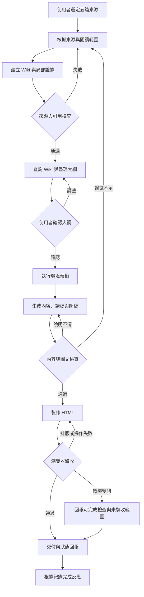

# Wiki → 教學簡報：工作流程與檢查迴圈

本次大綱與圖稿安排由使用者確認後進入製作。下圖描述 AI 助手依規範執行的工作流程；不是已部署的多代理程式，也沒有另行呼叫獨立 agent。

## 節點輸入、輸出與通過條件

| 節點 | 輸入／產出 | 主要檢查 | 失敗時 |
| --- | --- | --- | --- |
| 來源核對 | 五篇使用者選定資料 → 各版本與閱讀範圍 | 不是重複來源；文字、圖表與附錄範圍分開 | 回查原文；無法取得則保留未知 |
| Wiki 整理 | 來源文字 → 筆記、證據 ID、共同概念、比較 | 重要主張有具體位置；引用可回查；任務不混用 | 回來源或修正 Wiki |
| 大綱 | Wiki → 14 頁、20 分鐘與配圖規劃 | 入門者能依序理解；涵蓋研究應用與作業流程 | 由使用者提出修改，回大綱 |
| 環境預檢 | 執行環境 → 可用路徑、輸出與瀏覽啟動狀態 | 在完整生成前發現技術阻礙 | 修正可處理項目；記錄無法解除的阻礙 |
| 內容與圖稿 | 大綱＋Wiki → 逐頁內容與講稿、12 張 SVG | 文獻／假設分開；圖文相符；原創示意不冒充結果 | 證據問題回來源；教學問題回內容 |
| HTML | 逐頁成果 → 可獨立開啟的簡報 | 離線內容、引用、換頁、講稿、放大、列印 | 回 HTML 修正 |
| 驗收 | HTML → 結構、程式行為、瀏覽結果 | 各類檢查分開回報；受阻不等於通過 | 修正後重查；環境受阻如實保留 |
| 反思 | 實際執行事件與檢查結果 → 三題反思 | 不預寫錯誤頻率、不捏造失敗與通過 | 回實際紀錄，不由印象補造 |

## 哪些步驟會重複？為何這樣設計？

- 來源核對與證據檢查：在產生教學內容前確認任務與引用，減少後面整頁重寫。
- 內容、圖稿與圖文檢查：將讀者看不懂或示意不一致的問題留在內容階段修正。
- HTML 製作與驗收：修正可重現的排版或操作問題後，重跑受到影響的檢查。
- 本輪新增環境預檢：避免最後才發現無法啟動瀏覽器。環境受阻會保留待驗收狀態，不跳過驗收後宣稱完成。

## 實際執行證據

- [已確認的大綱](outline.md)
- [執行紀錄與反思](run-log.md)
- [機器可讀檢查結果](checks.json)
- [HTML 簡報](簡報.html)
- [Wiki 首頁](../../wiki/index.md)

這份 workflow 是可重複執行的操作設計；Wiki 的全部行為情境驗收與論文完整閱讀仍各自保留狀態。
